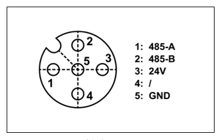
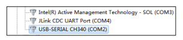
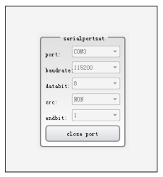
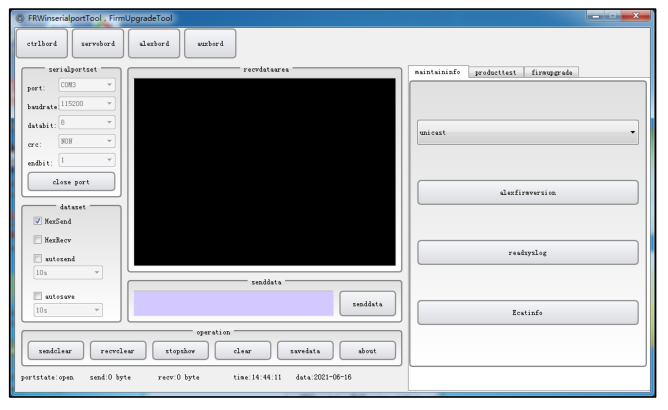
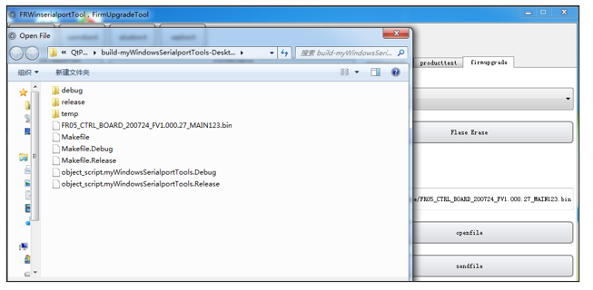
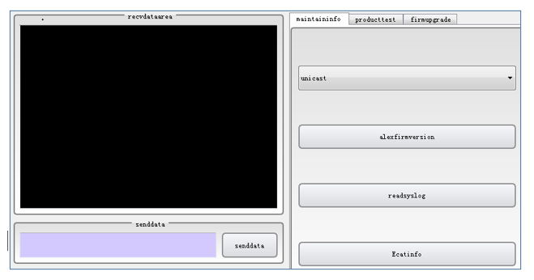
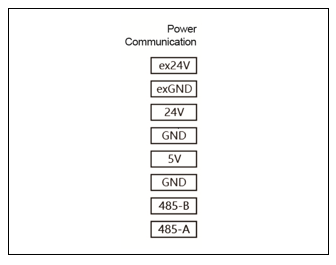

Apêndice
==============

.. toctree:: 
  :maxdepth: 5

Apêndice 1: Códigos de Erro do Controlador de Movimento e Soluções
----------------------------------------------------------------------------------------

.. csv-table:: 
   :header: "Código de falha principal", "Subcódigo de falha", "Descrição"
   :widths: 20, 10, 70

   "0-Sem falha", "0", "Sem falha"
   "1-Erro de ponto de comando", "1", "Erro do ponto de comando das juntas, reinicializável"
   "1-Erro de ponto de comando", "2", "Erro do ponto de destino linear (incluindo incompatibilidade de ferramenta), reinicializável"
   "1-Erro de ponto de comando", "3", "Erro do ponto intermediário do arco (incluindo incompatibilidade de ferramenta), reinicializável"
   "1-Erro de ponto de comando", "4", "Erro do ponto de destino do arco (incluindo incompatibilidade de ferramenta), reinicializável"
   "1-Erro de ponto de comando", "5", "Espaçamento dos pontos de comando do arco muito pequeno, reinicializável"
   "1-Erro de ponto de comando", "6", "Erro do ponto intermediário 1 do círculo completo/hélice (incluindo incompatibilidade de ferramenta), reinicializável"
   "1-Erro de ponto de comando", "7", "Erro do ponto intermediário 2 do círculo completo/hélice (incluindo incompatibilidade de ferramenta), reinicializável"
   "1-Erro de ponto de comando", "8", "Erro do ponto intermediário 3 do círculo completo/hélice (incluindo incompatibilidade de ferramenta), reinicializável"
   "1-Erro de ponto de comando", "9", "Espaçamento dos pontos de comando do círculo completo/hélice muito pequeno, reinicializável"
   "1-Erro de ponto de comando", "10", "Erro do ponto de comando TPD, reinicializável"
   "1-Erro de ponto de comando", "11", "A ferramenta do comando TPD não corresponde à ferramenta atual, reinicializável"
   "1-Erro de ponto de comando", "12", "Desvio entre o comando TPD atual e o ponto inicial do próximo comando muito grande, reinicializável"
   "1-Erro de ponto de comando", "13", "Erro de comutação de ferramenta interna/externa, reinicializável"
   "1-Erro de ponto de comando", "14", "Erro do ponto inicial da nova hélice, reinicializável"
   "1-Erro de ponto de comando", "15", "Erro do ponto de comando da nova curva spline, reinicializável"
   "1-Erro de ponto de comando", "17", "Comando de junta PTP além do limite, reinicializável"
   "1-Erro de ponto de comando", "18", "Comando de junta TPD além do limite, reinicializável"
   "1-Erro de ponto de comando", "19", "Comando de junta emitido por LIN/ARC além do limite, reinicializável"
   "1-Erro de ponto de comando", "20", "Sobrecarga de velocidade do comando no espaço cartesiano, não reinicializável"
   "1-Erro de ponto de comando", "21", "Comando de torque além do limite no espaço das juntas, reinicializável"
   "1-Erro de ponto de comando", "22", "Comando de junta JOG além do limite, reinicializável"
   "1-Erro de ponto de comando", "23", "Velocidade do comando no espaço das juntas do eixo 1 além do limite, reinicializável"
   "1-Erro de ponto de comando", "24", "Velocidade do comando no espaço das juntas do eixo 2 além do limite, reinicializável"
   "1-Erro de ponto de comando", "25", "Velocidade do comando no espaço das juntas do eixo 3 além do limite, reinicializável"
   "1-Erro de ponto de comando", "26", "Velocidade do comando no espaço das juntas do eixo 4 além do limite, reinicializável"
   "1-Erro de ponto de comando", "27", "Velocidade do comando no espaço das juntas do eixo 5 além do limite, reinicializável"
   "1-Erro de ponto de comando", "28", "Velocidade do comando no espaço das juntas do eixo 6 além do limite, reinicializável"
   "1-Erro de ponto de comando", "29", "Velocidade de feedback das juntas além do limite, não reinicializável"
   "1-Erro de ponto de comando", "30", "Desvio entre o comando de junta e o feedback muito grande, não reinicializável, reinício necessário"
   "1-Erro de ponto de comando", "31", "Erro do ponto de destino DMP (incluindo incompatibilidade de ferramenta), reinicializável"
   "1-Erro de ponto de comando", "33", "Configuração das juntas do próximo comando alterada (o próximo comando possui pose singular, use o comando PTP ou altere o ponto do próximo comando), reinicializável"
   "1-Erro de ponto de comando", "34", "Configuração das juntas do comando atual alterada (o próximo comando possui pose singular, use o comando PTP ou altere o ponto do próximo comando), reinicializável"
   "1-Erro de ponto de comando", "35", "Velocidade das juntas além do limite no comando LIN, reinicializável"
   "1-Erro de ponto de comando", "36", "A velocidade adaptativa do comando LIN excede o limite, reinicializável"
   "1-Erro de ponto de comando", "37", "Existe ponto inatingível na trajetória, reinicializável"
   "1-Erro de ponto de comando", "38", "Existe ponto inatingível na trajetória - pose singular, reinicializável"
   "1-Erro de ponto de comando", "49", "Erro de comando, entre ARCSTART e ARCEND apenas comandos LIN e ARC são permitidos, reinicializável"
   "1-Erro de ponto de comando", "50", "Erro de comando, entre WEAVESTART e WEAVEEND apenas comandos LIN e ARC são permitidos, reinicializável"
   "1-Erro de ponto de comando", "51", "Erro dos parâmetros de tecelagem, reinicializável"
   "1-Erro de ponto de comando", "52", "Espaçamento dos pontos de comando de tecelagem muito pequeno, reinicializável"
   "1-Erro de ponto de comando", "53", "Existe ponto inatingível na trajetória de tecelagem - pose singular, reinicializável"
   "1-Erro de ponto de comando", "54", "Existe ponto inatingível na trajetória de tecelagem - comando de junta além do limite, reinicializável"
   "1-Erro de ponto de comando", "55", "Existe ponto inatingível na trajetória de tecelagem - exceção de planejamento (o ângulo entre z da ferramenta e x da direção de avanço coincide), reinicializável"
   "1-Erro de ponto de comando", "56", "Existe ponto inatingível na trajetória de tecelagem - exceção de planejamento (erro do ponto de caminho do arco), reinicializável"
   "1-Erro de ponto de comando", "65", "Desvio do comando do sensor laser muito grande, reinicializável"
   "1-Erro de ponto de comando", "66", "Comando do sensor laser interrompido, rastreamento da costura de solda encerrado antecipadamente, reinicializável"
   "1-Erro de ponto de comando", "81", "Velocidade do comando do eixo externo além do limite, reinicializável"
   "1-Erro de ponto de comando", "82", "Desvio entre comando e feedback do eixo externo muito grande, não reinicializável, é necessário retornar à origem ou reiniciar"
   "1-Erro de ponto de comando", "83", "Comunicação do periférico estendido (eixo externo/IO) anormal, reinicializável"
   "1-Erro de ponto de comando", "84", "Comunicação do periférico estendido (máquina de solda) anormal, reinicializável"
   "1-Erro de ponto de comando", "85", "Velocidade do comando no espaço das juntas do eixo estendido 1 além do limite, reinicializável"
   "1-Erro de ponto de comando", "86", "Velocidade do comando no espaço das juntas do eixo estendido 2 além do limite, reinicializável"
   "1-Erro de ponto de comando", "87", "Velocidade do comando no espaço das juntas do eixo estendido 3 além do limite, reinicializável"
   "1-Erro de ponto de comando", "88", "Velocidade do comando no espaço das juntas do eixo estendido 4 além do limite, reinicializável"
   "1-Erro de ponto de comando", "89", "Comunicação do periférico estendido (UDP) anormal, reinicializável"
   "1-Erro de ponto de comando", "90", "Perda de pacotes na comunicação do periférico estendido (UDP) anormal, reinicializável"
   "1-Erro de ponto de comando", "97", "Rastreamento de esteira transportadora - variação de pose entre ponto inicial e ponto de referência muito grande, reinicializável"
   "1-Erro de ponto de comando", "113", "Controle de força constante - direção X excede a distância máxima de ajuste, reinicializável"
   "1-Erro de ponto de comando", "114", "Controle de força constante - direção Y excede a distância máxima de ajuste, reinicializável"
   "1-Erro de ponto de comando", "115", "Controle de força constante - direção Z excede a distância máxima de ajuste, reinicializável"
   "1-Erro de ponto de comando", "116", "Controle de força constante - direção RX excede o ângulo máximo de ajuste, reinicializável"
   "1-Erro de ponto de comando", "117", "Controle de força constante - direção RY excede o ângulo máximo de ajuste, reinicializável"
   "1-Erro de ponto de comando", "118", "Controle de força constante - direção RZ excede o ângulo máximo de ajuste, reinicializável"
   "1-Erro de ponto de comando", "119", "Erro nos dados do sensor externo, reinicializável"
   "1-Erro de ponto de comando", "120", "Movimento de exploração helicoidal falhou, reinicializável"
   "1-Erro de ponto de comando", "121", "Movimento de inserção rotacional falhou, reinicializável"
   "1-Erro de ponto de comando", "122", "Movimento de inserção linear falhou, reinicializável"
   "1-Erro de ponto de comando", "123", "Movimento de posicionamento de superfície falhou, reinicializável"
   "1-Erro de ponto de comando", "129", "Número máximo de pontos de registro de torque excedido, reinicializável"
   "1-Erro de ponto de comando", "130", "Erro de comutação de velocidade, reinicializável"
   "1-Erro de ponto de comando", "131", "Direção da ferramenta além do limite, reinicializável"
   "1-Erro de ponto de comando", "132", "Momento além do limite, reinicializável"
   "1-Erro de ponto de comando", "133", "Potência além do limite, reinicializável"
   "1-Erro de ponto de comando", "134", "Diagnóstico STL-Flash anormal, reinicializável"
   "1-Erro de ponto de comando", "135", "Diagnóstico STL-RAM anormal, reinicializável"
   "1-Erro de ponto de comando", "136", "Diagnóstico STL-CPU anormal, reinicializável"
   "1-Erro de ponto de comando", "137", "Dados de segurança ECAT da placa de segurança II anormais, reinicializável"
   "1-Erro de ponto de comando", "138", "Dados de segurança ECAT do eixo 1 anormais, reinicializável"
   "1-Erro de ponto de comando", "139", "Dados de segurança ECAT do eixo 2 anormais, reinicializável"
   "1-Erro de ponto de comando", "140", "Dados de segurança ECAT do eixo 3 anormais, reinicializável"
   "1-Erro de ponto de comando", "141", "Dados de segurança ECAT do eixo 4 anormais, reinicializável"
   "1-Erro de ponto de comando", "142", "Dados de segurança ECAT do eixo 5 anormais, reinicializável"
   "1-Erro de ponto de comando", "143", "Dados de segurança ECAT do eixo 6 anormais, reinicializável"
   "1-Erro de ponto de comando", "145", "Comunicação entre a placa de segurança e a caixa de controle anormal, reinicializável"
   "1-Erro de ponto de comando", "146", "Erro de seguimento de foco, reinicializável"
   "1-Erro de ponto de comando", "147", "Velocidade de atitude além do limite, reinicializável"
   "1-Erro de ponto de comando", "148", "Palavra de status das juntas anormal, reinicializável"
   "1-Erro de ponto de comando", "149", "Conflito de função ou configuração, reinicializável"
   "2-Falha do driver", "1", "Falha do driver do eixo 1, não reinicializável"
   "2-Falha do driver", "2", "Falha do driver do eixo 2, não reinicializável"
   "2-Falha do driver", "3", "Falha do driver do eixo 3, não reinicializável"
   "2-Falha do driver", "4", "Falha do driver do eixo 4, não reinicializável"
   "2-Falha do driver", "5", "Falha do driver do eixo 5, não reinicializável"
   "2-Falha do driver", "6", "Falha do driver do eixo 6, não reinicializável"
   "3-Falha de limite soft excedido", "1", "Falha de limite soft excedido do eixo 1, reinicializável"
   "3-Falha de limite soft excedido", "2", "Falha de limite soft excedido do eixo 2, reinicializável"
   "3-Falha de limite soft excedido", "3", "Falha de limite soft excedido do eixo 3, reinicializável"
   "3-Falha de limite soft excedido", "4", "Falha de limite soft excedido do eixo 4, reinicializável"
   "3-Falha de limite soft excedido", "5", "Falha de limite soft excedido do eixo 5, reinicializável"
   "3-Falha de limite soft excedido", "6", "Falha de limite soft excedido do eixo 6, reinicializável"
   "4-Falha de colisão", "1", "Falha de colisão do eixo 1, reinicializável"
   "4-Falha de colisão", "2", "Falha de colisão do eixo 2, reinicializável"
   "4-Falha de colisão", "3", "Falha de colisão do eixo 3, reinicializável"
   "4-Falha de colisão", "4", "Falha de colisão do eixo 4, reinicializável"
   "4-Falha de colisão", "5", "Falha de colisão do eixo 5, reinicializável"
   "4-Falha de colisão", "6", "Falha de colisão do eixo 6, reinicializável"
   "4-Falha de colisão", "7", "Falha de colisão na extremidade, reinicializável"
   "4-Falha de colisão", "8", "Falha de colisão do eixo externo, reinicializável"
   "5-Erro na quantidade de slaves ativos", "1", "Erro na quantidade de slaves ativos, não reinicializável"
   "6-Erro de slave", "1", "Slave offline, não reinicializável"
   "6-Erro de slave", "2", "Status do slave inconsistente com o valor definido, não reinicializável"
   "6-Erro de slave", "3", "Slave não configurado, não reinicializável"
   "6-Erro de slave", "4", "Erro de configuração do slave, não reinicializável"
   "6-Erro de slave", "5", "Erro de inicialização do slave, não reinicializável"
   "6-Erro de slave", "6", "Erro de inicialização da comunicação mailbox do slave, não reinicializável"
   "7-Erro de IO", "1", "Erro de canal, reinicializável"
   "7-Erro de IO", "2", "Erro de valor, reinicializável"
   "7-Erro de IO", "3", "Timeout de espera do WaitDI, reinicializável"
   "7-Erro de IO", "4", "Timeout de espera do WaitAI, reinicializável"
   "7-Erro de IO", "5", "Timeout de espera do WaitAxleDI, reinicializável"
   "7-Erro de IO", "6", "Timeout de espera do WaitAxleAI, reinicializável"
   "7-Erro de IO", "7", "Erro de função já configurada no canal, reinicializável"
   "7-Erro de IO", "8", "Timeout de abertura do arco, reinicializável"
   "7-Erro de IO", "9", "Timeout de fechamento do arco, reinicializável"
   "7-Erro de IO", "10", "Timeout de busca de costura, reinicializável"
   "7-Erro de IO", "11", "Timeout de detecção de IO da esteira transportadora, reinicializável"
   "7-Erro de IO", "12", "Timeout de espera do WaitAuxDI, reinicializável"
   "7-Erro de IO", "13", "Timeout de espera do WaitAuxAI, reinicializável"
   "7-Erro de IO", "14", "Timeout de busca de costura do arame de solda, reinicializável"
   "7-Erro de IO", "15", "Parada de segurança acionada, reinicializável"
   "7-Erro de IO", "16", "Proteção contra curto-circuito de 24V do módulo DO, não reinicializável"
   "7-Erro de IO", "17", "Proteção de manutenção de posição (falha do freio), não reinicializável"
   "7-Erro de IO", "18", "Timeout de espera do DI da placa, reinicializável"
   "7-Erro de IO", "19", "Timeout de espera do AI da placa, reinicializável"
   "8-Erro da garra", "1", "Erro de timeout do movimento da garra, reinicializável"
   "9-Erro de arquivo", "1", "Erro de versão do arquivo de configuração zbt, erro de inicialização - não reinicializável"
   "9-Erro de arquivo", "2", "Falha ao carregar o arquivo de configuração zbt, erro de inicialização - não reinicializável"
   "9-Erro de arquivo", "3", "Erro de versão do arquivo de configuração user, erro de inicialização - não reinicializável"
   "9-Erro de arquivo", "4", "Falha ao carregar o arquivo de configuração user, erro de inicialização - não reinicializável"
   "9-Erro de arquivo", "5", "Erro de versão do arquivo de configuração exaxis, erro de inicialização - não reinicializável"
   "9-Erro de arquivo", "6", "Falha ao carregar o arquivo de configuração exaxis, erro de inicialização - não reinicializável"
   "9-Erro de arquivo", "7", "Modelo de robô inconsistente, é necessário reconfigurar - não reinicializável"
   "9-Erro de arquivo", "8", "Erro de versão do arquivo de configuração dhpara, erro de inicialização - não reinicializável"
   "9-Erro de arquivo", "9", "Falha ao carregar o arquivo de configuração dhpara, erro de inicialização - não reinicializável"
   "9-Erro de arquivo", "10", "Modelo de robô não definido - não reinicializável"
   "9-Erro de arquivo", "11", "Erro de versão do arquivo de configuração load, erro de inicialização - não reinicializável"
   "9-Erro de arquivo", "12", "Falha ao carregar o arquivo de configuração load, erro de inicialização - não reinicializável"
   "9-Erro de arquivo", "13", "Erro de versão do arquivo de configuração speed, erro de inicialização - não reinicializável"
   "9-Erro de arquivo", "14", "Falha ao carregar o arquivo de configuração speed, erro de inicialização - não reinicializável"
   "9-Erro de arquivo", "15", "Erro de versão do arquivo de configuração weavepara, erro de inicialização - não reinicializável"
   "9-Erro de arquivo", "16", "Falha ao carregar o arquivo de configuração weavepara, erro de inicialização - não reinicializável"
   "9-Erro de arquivo", "17", "Erro de versão do arquivo de configuração interfere, erro de inicialização - não reinicializável"
   "9-Erro de arquivo", "18", "Falha ao carregar o arquivo de configuração interfere, erro de inicialização - não reinicializável"
   "9-Erro de arquivo", "19", "Erro de versão do arquivo de configuração dynamic, erro de inicialização - não reinicializável"
   "9-Erro de arquivo", "20", "Falha ao carregar o arquivo de configuração dynamic, erro de inicialização - não reinicializável"
   "10-Pose singular", "1", "Pose singular"
   "11-Erro de comunicação do driver", "1", "Erro de comunicação do driver do eixo 1, não reinicializável"
   "11-Erro de comunicação do driver", "2", "Erro de comunicação do driver do eixo 2, não reinicializável"
   "11-Erro de comunicação do driver", "3", "Erro de comunicação do driver do eixo 3, não reinicializável"
   "11-Erro de comunicação do driver", "4", "Erro de comunicação do driver do eixo 4, não reinicializável"
   "11-Erro de comunicação do driver", "5", "Erro de comunicação do driver do eixo 5, não reinicializável"
   "11-Erro de comunicação do driver", "6", "Erro de comunicação do driver do eixo 6, não reinicializável"
   "12-Limite soft do eixo externo", "1", "Limite soft do eixo 1 excedido, reinicializável"
   "12-Limite soft do eixo externo", "2", "Limite soft do eixo 2 excedido, reinicializável"
   "12-Limite soft do eixo externo", "3", "Limite soft do eixo 3 excedido, reinicializável"
   "12-Limite soft do eixo externo", "4", "Limite soft do eixo 4 excedido, reinicializável"
   "13-Erro de configuração de parâmetro", "1", "Número da ferramenta além do limite, reinicializável"
   "13-Erro de configuração de parâmetro", "2", "Erro do limite de conclusão do posicionamento, reinicializável"
   "13-Erro de configuração de parâmetro", "3", "Erro do nível de colisão, reinicializável"
   "13-Erro de configuração de parâmetro", "4", "Erro do peso da carga, reinicializável"
   "13-Erro de configuração de parâmetro", "5", "Erro do centro de massa X da carga, reinicializável"
   "13-Erro de configuração de parâmetro", "6", "Erro do centro de massa Y da carga, reinicializável"
   "13-Erro de configuração de parâmetro", "7", "Erro do centro de massa Z da carga, reinicializável"
   "13-Erro de configuração de parâmetro", "8", "Erro do tempo de filtragem DI, reinicializável"
   "13-Erro de configuração de parâmetro", "9", "Erro do tempo de filtragem AxleDI, reinicializável"
   "13-Erro de configuração de parâmetro", "10", "Erro do tempo de filtragem AI, reinicializável"
   "13-Erro de configuração de parâmetro", "11", "Erro do tempo de filtragem AxleAI, reinicializável"
   "13-Erro de configuração de parâmetro", "12", "Erro da faixa de nível alto/baixo do DI, reinicializável"
   "13-Erro de configuração de parâmetro", "13", "Erro da faixa de nível alto/baixo do DO, reinicializável"
   "13-Erro de configuração de parâmetro", "14", "Número da peça de trabalho além do limite, reinicializável"
   "13-Erro de configuração de parâmetro", "15", "Número do eixo externo além do limite, reinicializável"
   "13-Erro de configuração de parâmetro", "16", "Erro do canal do encoder da esteira transportadora, reinicializável"
   "13-Erro de configuração de parâmetro", "17", "Erro do número do eixo da peça de trabalho da esteira transportadora, reinicializável"
   "13-Erro de configuração de parâmetro", "18", "Erro do método de instalação do FR30L - não montagem vertical, reinicializável"

Apêndice 2: Tabela de Falhas da Caixa de Controle de Larga Tensão
---------------------------------------------------------------------------------

.. list-table::
   :widths: 20 40 80
   :header-rows: 0
   :align: center

   * - **Código de Falha**
     - **Nome da Falha**
     - **Método de Resolução**

   * - 3
     - MCU Auxiliar Offline
     - | 1. Regravar o firmware da MCU auxiliar
       | 2. Reparar a MCU auxiliar ou substituir a caixa de controle  

   * - 4
     - Inconsistência de Entrada de Emergência das MCUs Principal e Auxiliar
     - | 1. Verificar o chicote de fios do botão de emergência da caixa de botões ou substituir o conjunto da caixa de botões
       | 2. Verificar os dois chicotes de curto-circuito de emergência nos terminais da caixa de controle  
       | 3. Se a falha persistir, reparar ou substituir a caixa de controle 

   * - 5
     - Inconsistência de Entrada de Segurança das MCUs Principal e Auxiliar
     - | 1. Verificar os dois chicotes de curto-circuito de segurança nos terminais da caixa de controle
       | 2. Se a falha persistir, reparar ou substituir a caixa de controle

   * - 6
     - Inconsistência de Entrada de Emergência e Habilitação de 3 Posições das MCUs Principal e Auxiliar
     - | 1. Verificar o interruptor de habilitação de 3 posições do teach pendant e o chicote de fios do teach pendant
       | 2. Substituir o conjunto do teach pendant
       | 3. Verificar se o Web está no modo teach pendant e se o teach pendant está conectado
       | 4. Se a falha persistir, reparar ou substituir a caixa de controle

   * - 7
     - Inconsistência de Entrada/Saída STO Principal
     - | 1. Verificar se o conector do cabo pesado da caixa de controle e o chicote STO estão firmemente conectados
       | 2. Verificar se o drive suporta a função STO
       | 3. Para configuração caixa de controle certificada de larga tensão + robô não certificado, verificar se o modo de segurança funcional está ativado
       | 4. A caixa de controle certificada de larga tensão no modo de certificação ativa a detecção de falhas STO; o robô não certificado não suporta o modo de segurança funcional
       | 5. Se a falha persistir, reparar ou substituir a caixa de controle

   * - 8
     - Inconsistência de Entrada/Saída STO Auxiliar
     - | 1. Verificar se o conector do cabo pesado da caixa de controle e o chicote STO estão firmemente conectados
       | 2. Verificar se o drive suporta a função STO
       | 3. Para configuração caixa de controle certificada de larga tensão + robô não certificado, verificar se o modo de segurança funcional está ativado
       | 4. A caixa de controle certificada de larga tensão no modo de certificação ativa a detecção de falhas STO; o robô não certificado não suporta o modo de segurança funcional
       | 5. Se a falha persistir, reparar ou substituir a caixa de controle

   * - 9
     - MCU Principal Detecta Inconsistência de Entrada/Saída do Relé 48V
     - | 1. Verificar a entrada e o feedback do relé de guia forçada na caixa de controle
       | 2. Verificar se o relé 48V na caixa de controle está colado
       | 3. Verificar se o circuito de feedback do relé 48V na caixa de controle está funcionando corretamente
       | 4. Se a falha persistir, reparar ou substituir a caixa de controle

   * - 10
     - MCU Auxiliar Detecta Inconsistência de Entrada/Saída do Relé 48V
     - | 1. Verificar a entrada e o feedback do relé de guia forçada na caixa de controle
       | 2. Verificar se o relé 48V na caixa de controle está colado
       | 3. Verificar se o circuito de feedback do relé 48V na caixa de controle está funcionando corretamente
       | 4. Se a falha persistir, reparar ou substituir a caixa de controle

   * - \
     - Caixa de Controle Desligada, Sem Saída 48V
     - | 1. Verificar o circuito relacionado ao chip de proteção contra curto-circuito 24V e verificar se há curtos-circuitos no 24V
       | 2. Verificar os chicotes de curto-circuito dos terminais de entrada de emergência e entrada de segurança
       | 3. Verificar se a placa secundária de alimentação 24V da caixa de controle está fornecendo 24V
       | 4. Se a falha persistir, reparar ou substituir a caixa de controle

Apêndice 3: Tabela de Códigos de Falha do Servo Driver
-------------------------------------------------------------------------

.. list-table::
   :widths: 20 40 80
   :header-rows: 0
   :align: center

   * - **Código**
     - **Nome da Falha**
     - **Procedimento**

   * - 1
     - Sobrecorrente de software
     - | 1. Verifique se a carga ou resistência da junta aumentou ou está anormal.
       | 2. Se a falha persistir, repare ou substitua a placa de acionamento.

   * - 2
     - Sobretensão
     - Reduza a velocidade ou aceleração do robô.

   * - 3
     - Subtensão
     - | 1. Verifique se a saída de tensão da fonte de alimentação de 48V da caixa de controle está anormal.
       | 2. Verifique se há curto-circuito entre a placa de acionamento e o invólucro da junta.
       | 3. Se a falha persistir, repare ou substitua a placa de acionamento.

   * - 4
     - Superaquecimento
     - Reduza a carga ou a velocidade de operação do robô.

   * - 5
     - Sobrecarga
     - Reduza a carga ou a velocidade de operação do robô.

   * - 6
     - Excesso de velocidade
     - | 1. Verifique se o parafuso de fixação entre o módulo magnético e o eixo do motor está solto.
       | 2. Reexecute a calibração do codificador.
       | 3. Se a falha persistir, repare ou substitua o módulo magnético.

   * - 7
     - Falha de parâmetro anormal
     - Repare ou substitua a placa de acionamento.

   * - 8
     - Falha de descontrole (overspeed)
     - | 1. Verifique se o parafuso de fixação entre o módulo magnético e o eixo do motor está solto.
       | 2. Reexecute a calibração do codificador.
       | 3. Se a falha persistir, repare ou substitua o módulo magnético.

   * - 9
     - Falha de erro de posição
     - | 1. Verifique se a carga ou resistência da junta aumentou ou está anormal.
       | 2. Se a falha persistir, repare ou substitua a placa de acionamento.

   * - 10
     - Falha de estouro de posição
     - | 1. Verifique se o limite físico está solto.
       | 2. Reexecute a calibração do robô.

   * - 11
     - Sobrecorrente de hardware
     - Repare ou substitua a placa de acionamento.

   * - 12
     - Falha de inibição de acionamento
     - Não utilizado.

   * - 13
     - Falha de bloqueio do motor
     - | 1. Verifique se o eletroímã do freio está acionado.
       | 2. Verifique se houve colisão com o limite físico.
       | 3. Se a falha persistir, repare ou substitua a placa de acionamento.

   * - 14
     - Falha na fonte de alimentação de potência
     - Não utilizado.

   * - 15
     - Falha STO
     - Não utilizado.

   * - 16
     - Falha de ajuste de zero da corrente de fase AD
     - Repare ou substitua a placa de acionamento.

   * - 17
     - Falha EEPROM
     - Repare ou substitua a placa de acionamento.

   * - 18
     - Falha Hall
     - | 1. Verifique se o chicote Hall está firmemente conectado, sem curto ou circuito aberto.
       | 2. Se a falha persistir, repare ou substitua a junta.

   * - 19
     - Falha do codificador
     - Repare ou substitua o módulo magnético.

   * - 20
     - Falha de ajuste de zero do codificador
     - | 1. Reexecute a calibração do codificador.
       | 2. Se a falha persistir, repare ou substitua o módulo magnético.
   
   * - 21
     - Falha de perda do sinal Z do codificador
     - Não utilizado.

   * - 22
     - Falha de contagem do codificador
     - Não utilizado.

   * - 23
     - Falha de estouro de dados multivolta do codificador
     - Não utilizado.

   * - 24
     - Falha de clock externo
     - Repare ou substitua a placa de acionamento.

   * - 25
     - Falha de sequência de fases UVW
     - Não utilizado.

   * - 26
     - Falha FPGA
     - Não utilizado.

   * - 27
     - Falha de retorno à origem
     - Não utilizado.

   * - 28
     - Falha do codificador magnético
     - | 1. Verifique se o parafuso de fixação entre o módulo magnético e o eixo do motor está solto.
       | 2. Se a falha persistir, repare ou substitua o módulo magnético.

   * - 29
     - Falha de fio de alimentação do motor rompido
     - | 1. Verifique se o cabo de alimentação do motor está firmemente conectado, sem curto ou circuito aberto.
       | 2. Se a falha persistir, repare ou substitua a placa de acionamento.

   * - 30
     - Falha EtherCAT
     - | 1. Verifique se o cabo de rede está firmemente conectado, sem curto ou circuito aberto.
       | 2. Se a falha persistir, repare ou substitua a placa de acionamento.

   * - 31
     - Falha EtherCAT_SM_DOG
     - | 1. Verifique se o cabo de rede está firmemente conectado, sem curto ou circuito aberto.
       | 2. Se a falha persistir, repare ou substitua a placa de acionamento.

   * - 32
     - Falha EtherCAT_FATALSYNC
     - | 1. Verifique se o cabo de rede está firmemente conectado, sem curto ou circuito aberto.
       | 2. Se a falha persistir, repare ou substitua a placa de acionamento.

   * - 33
     - Falha EtherCAT_SYNC
     - | 1. Verifique se o cabo de rede está firmemente conectado, sem curto ou circuito aberto.
       | 2. Se a falha persistir, repare ou substitua a placa de acionamento.

   * - 34
     - Falha EtherCAT_RFT
     - | 1. Verifique se o cabo de rede está firmemente conectado, sem curto ou circuito aberto.
       | 2. Se a falha persistir, repare ou substitua a placa de acionamento.

   * - 35
     - Falha de endereço do eixo do driver
     - | 1. Reconfigure o endereço do eixo do driver.
       | 2. Se a falha persistir, repare ou substitua a placa de acionamento.

   * - 36
     - Falha de calibração do robô
     - | 1. Reexecute a calibração do robô.
       | 2. Primeiro, use o JLINK para apagar a FLASH, depois recarregue o programa e recalibre.
       | 3. Se a falha persistir, repare ou substitua a placa de acionamento.

   * - 37
     - Falha de comunicação do codificador
     - | 1. Verifique se o chicote do codificador está firmemente conectado, sem curto ou circuito aberto.
       | 2. Se a falha persistir, repare ou substitua o módulo magnético.

   * - 40
     - Falha do módulo magnético - falha de calibração
     - | 1. Reexecute a calibração do módulo magnético.
       | 2. Se a falha persistir, repare ou substitua o módulo magnético.

   * - 41
     - Falha do módulo magnético - falha multivolta
     - | 1. Verifique se o parafuso de fixação entre o módulo magnético e o eixo do motor está solto.
       | 2. Se a falha persistir, repare ou substitua o módulo magnético.

   * - 42
     - Falha do módulo magnético - falha do pequeno codificador magnético multivolta
     - | 1. Verifique se o chip do pequeno codificador magnético multivolta está anormal.
       | 2. Se a falha persistir, repare ou substitua o módulo magnético.

   * - 43
     - Falha do módulo magnético - falha do grande codificador magnético multivolta
     - | 1. Verifique se o chip do grande codificador magnético multivolta está anormal.
       | 2. Se a falha persistir, repare ou substitua o módulo magnético.

   * - 44
     - Falha do módulo magnético - falha do codificador magnético de volta única
     - | 1. Verifique se o chip do codificador magnético de volta única está anormal.
       | 2. Se a falha persistir, repare ou substitua o módulo magnético.

   * - 45
     - Falha do módulo magnético - falha do codificador óptico
     - | 1. Verifique se o disco de codificação óptico está contaminado ou mal fixado.
       | 2. Se a falha persistir, repare ou substitua o módulo magnético.

   * - 46
     - Falha de Configuração do Tipo de Robô
     - | 1. Sem desligar a energia, verificar o número da versão do firmware do drive com falha
       | 2. Reconfigurar o tipo de robô
       | 3. Se a falha persistir, substituir ou reparar a placa do drive

   * - 47
     - Falha de Detecção de Tensão do Freio
     - | 1. Verificar se a fiação do freio está anormal
       | 2. Verificar se o circuito do freio está anormal

   * - 50
     - Falha no Comando de Posição
     - | 1. Verificar se o comando de posição enviado pelo computador host (controlador) está anormal (ou mutação do comando de posição)

   * - 51
     - Falha no Módulo do Encoder Magnético - Falha no Encoder Óptico
     - | 1. Verificar se a fiação do sensor de torque está anormal
       | 2. Se a falha persistir, reparar ou substituir o sensor de torque

Apêndice 4: Atualização via 485 da Placa de Extremidade
-------------------------------------------------------------------------

Durante o uso em campo, pode ser necessário atualizar o firmware para atender a novos requisitos. Um novo arquivo de atualização (XX_XX_MAIN.bin) será fornecido. A atualização da placa de extremidade é feita através da interface 485 (requer um conversor USB para 485). Os passos para a atualização são:

**Etapa 1: Conexão 485**, há um conector circular de comunicação de 5 pinos na extremidade do robô. A distribuição dos pinos e suas descrições são mostradas na Figura 1. Conecte o 485-A e 485-B da extremidade do robô aos terminais A e B do conversor USB-485 usando um par trançado.

.. centered:: Figura 18.3-1 Distribuição dos Pinos do Conector Circular

**Etapa 2: Conexão de hardware**, conecte o terminal USB do conversor USB-485 ao PC. No Gerenciador de Dispositivos do PC, se a ferramenta USB-485 for reconhecida, a seguinte interface aparecerá.

.. centered:: Figura 18.3-2 Identificação da Porta USB-485

**Etapa 3: Ferramenta de atualização**, após concluir a conexão, abra o “Assistente de Porta Serial FAIRINO”. Clique no botão “Placa de Extremidade”. Na seção “Configurações da Porta Serial”, selecione a porta serial identificada acima, configure a taxa de baud rate para 115200, 8 bits de dados, sem paridade, 1 bit de parada e, em seguida, abra a porta serial. Após a abertura bem-sucedida, a mensagem “Porta serial aberta com sucesso” será exibida.

.. centered:: Figura 18.3-3 Configurações da Porta Serial

**Etapa 4: Atualização do firmware**, selecione “Placa de Extremidade” e clique em “Atualização de Firmware”, conforme mostrado na figura:

.. centered:: Figura 18.3-4 Atualização de Firmware da Placa de Extremidade

-  Primeiro, clique em “Apagar Flash”. Após o sucesso da operação, uma mensagem de “Apagado com sucesso” aparecerá na área de recepção de dados.

-  Abra o arquivo (arquivo a ser atualizado), selecione o caminho onde ele está armazenado. Conforme mostrado abaixo, após a seleção, o nome do arquivo aparecerá na caixa de exibição.

.. centered:: Figura 18.3-5 Selecionar o Arquivo de Atualização

-  Clique em “Enviar Arquivo”. Quando a barra de progresso indicar 100%, significa que o envio do arquivo de atualização foi concluído.

**Etapa 5: Verificação da atualização**, reinicie o sistema. Na seção “Informações de Manutenção”, selecione “Consultar versão do firmware da placa de extremidade”. A versão do firmware será exibida na “Área de Recepção de Dados”. Se a versão for consistente com a do arquivo atualizado, a atualização foi bem-sucedida; caso contrário, a atualização falhou.

.. centered:: Figura 18.3-6 Consultar Versão do Firmware

Apêndice 5: Atualização via 485 da Caixa de Controle
----------------------------------------------------------------------

Na placa da caixa de controle do robô, há um conector “Fonte de Alimentação/Comunicação”. Conecte os terminais A e B da ferramenta USB-485 aos pinos “485-A” e “485-B” deste conector.

O processo de atualização é o mesmo da placa de extremidade; basta selecionar o software correspondente. Não será repetido aqui.

.. centered:: Figura 18.4-1 Conector de Fonte de Alimentação/Comunicação

Apêndice 6: Lista de Peças de Reposição e Peças Sujeitas a Desgaste
---------------------------------------------------------------------------

.. list-table::
   :widths: 40 40 20
   :header-rows: 0
   :align: center

   * - **Peça**
     - **Número**
     - **Quantidade**

   * - Parafuso M8*30
     - 4.0.08.2006185
     - 4

   * - Pino Cilíndrico Tipo A 8*20
     - 4.5.00.2013076
     - 2

   * - Fusível 5x20 6A
     - 
     - 1