Segurança
===============

.. toctree:: 
   :maxdepth: 6

Contexto
------------------------------------------------
Como unidade de execução fundamental no desenvolvimento da manufatura inteligente industrial, o desempenho de segurança dos robôs industriais tornou-se um elemento central na gestão do ciclo de vida completo dos equipamentos. Atualmente, o setor geralmente exige que os parâmetros relacionados às funções de segurança sejam fixos e imutáveis, e que seja estabelecido um mecanismo de verificação completo e rastreável para atender aos rigorosos requisitos de auditoria de conformidade de segurança.
Integradores de sistemas e usuários finais na Europa exigiram ainda mais transparência e verificabilidade da configuração de segurança na aceitação real de projetos. Especificamente, após a conclusão da depuração das funções de segurança, o sistema deve ser capaz de gerar automaticamente um relatório de configuração de segurança contendo um checksum de integridade, e este checksum deve ser exibido em tempo real na interface de gerenciamento Web do dispositivo. Este mecanismo visa garantir que quaisquer modificações nos parâmetros de segurança possam ser efetivamente identificadas e registradas, fornecendo assim uma base confiável para a avaliação do estado de segurança do dispositivo, aceitação no local e manutenção posterior.
Em vista disso, o projeto da arquitetura de segurança deste dispositivo não apenas está em conformidade com as normas internacionais de segurança relevantes, mas também possui funções integradas de exportação de configuração de segurança e exibição em tempo real do checksum, para auxiliar operadores e gerentes de segurança a concluir de forma conveniente e confiável a confirmação de configuração e a certificação de conformidade.

Checksum da Configuração de Segurança
------------------------------------------------

Abra a página web. O checksum de segurança está localizado no canto superior direito da página, representado por um número hexadecimal de 8 dígitos. O checksum de segurança é único; quando os parâmetros de configuração de segurança mudam, o checksum de segurança muda de acordo.

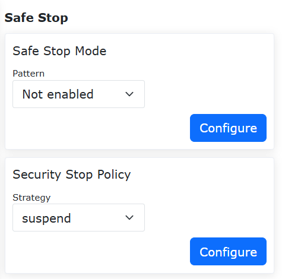

.. centered:: Figura 7.1-1 Exibição do Checksum da Configuração de Segurança

Clique no checksum de segurança para exibir o conjunto de parâmetros de configuração de segurança representados pelo checksum atual.

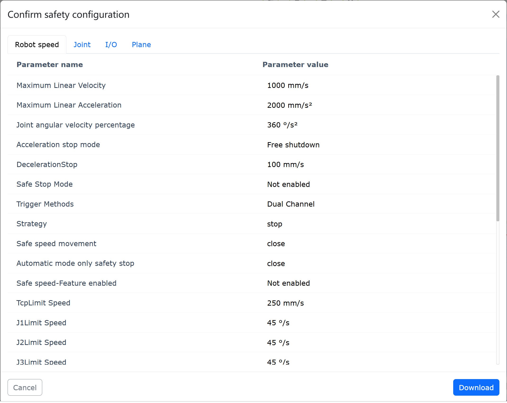

.. centered:: Figura 7.1-2 Parâmetros de Configuração de Segurança

Os parâmetros de configuração de segurança suportam a exportação de relatórios PDF. Clique em Download para visualizar a prévia do relatório PDF, e também suporta exportação. Clique no botão Salvar para baixar o relatório PDF.

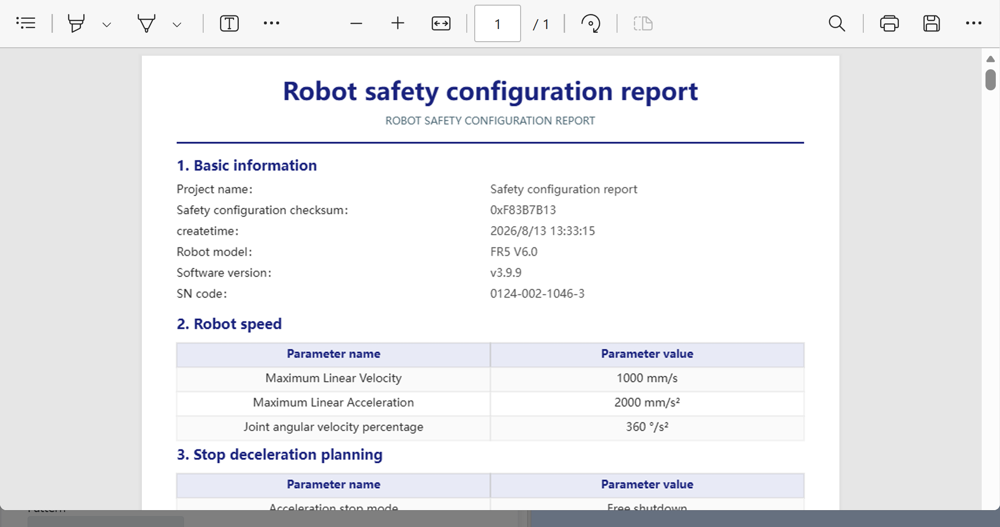

.. centered:: Figura 7.1-3 Pré-visualização do PDF do Relatório de Configuração de Segurança

Gerenciamento de Parâmetros de Configuração de Segurança
----------------------------------------------------------------

Todos os parâmetros de configuração de segurança relacionados ao robô são gerenciados uniformemente na página web "Configuração Inicial" -> "Segurança". A modificação dos parâmetros de configuração de segurança requer primeiro a inserção da "Senha de Configuração de Segurança" para verificação. Somente após a verificação bem-sucedida, as modificações na configuração dos parâmetros de segurança podem ser feitas.

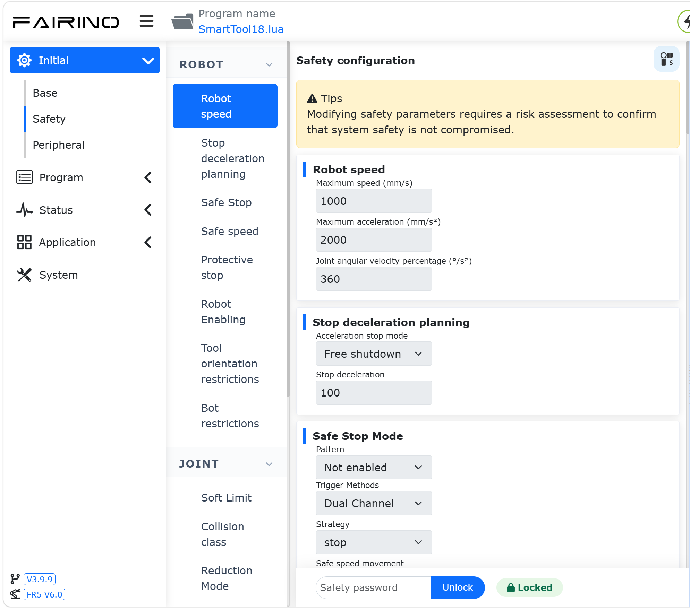

.. centered:: Figura 7.2-1 Verificação da Senha de Configuração de Segurança

Após modificar os parâmetros de configuração de segurança, clique em "Aplicar". Uma segunda confirmação dos parâmetros de configuração de segurança modificados é necessária. Clique em "Confirmar" para aplicar os parâmetros. Após a aplicação bem-sucedida dos parâmetros, o checksum de configuração de segurança será atualizado de acordo.

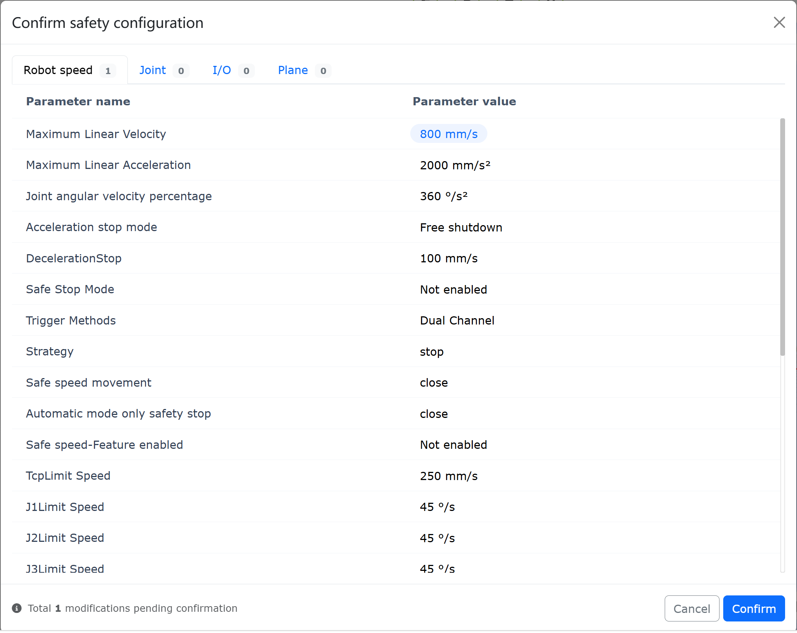

.. centered:: Figura 7.2-2 Segunda Confirmação dos Parâmetros de Configuração de Segurança

Funções de Cibersegurança
------------------------------------------------------------------------

Gerenciamento de Senha de Segurança
~~~~~~~~~~~~~~~~~~~~~~~~~~~~~~~~~~~~~~~~~~~~~~~~~~~~~~~~~~~~~~~~~~~~~~~~~~~~~~

Modificação da Senha de Segurança
+++++++++++++++++++++++++++++++++++++++++++++++++++++++++++++++++++++

A senha de segurança padrão é "12345678". A senha de segurança pode ser modificada na página "Segurança". Clique no botão "Modificar Senha de Segurança" para abrir a janela de modificação da senha de segurança. Insira a senha antiga e a nova senha, respectivamente, para concluir a modificação da senha de segurança.

.. centered:: Figura 7.3-1 Botão de Modificação da Senha de Segurança

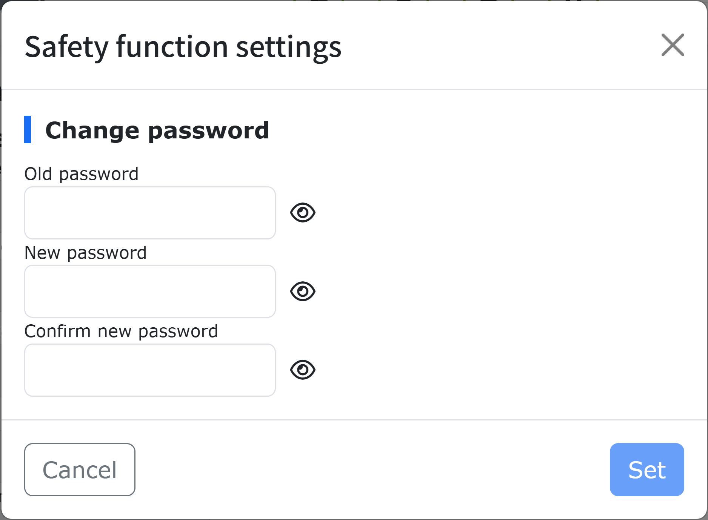

.. centered:: Figura 7.3-2 Janela de Modificação da Senha de Segurança

A nova e a antiga senha de segurança não podem ser iguais. A senha de segurança deve ter pelo menos 8 caracteres e deve conter letras maiúsculas e minúsculas, dígitos e caracteres especiais.

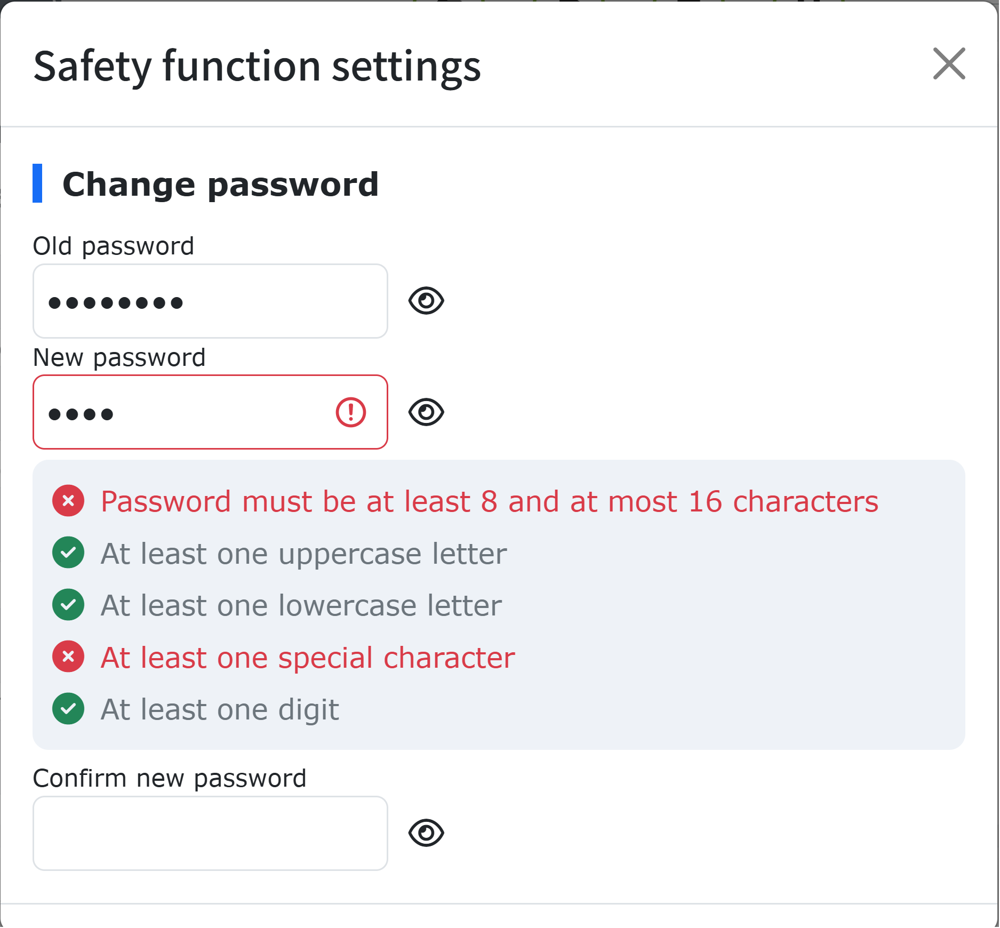

.. centered:: Figura 7.3-3 Verificação de Complexidade da Senha de Segurança

Proteção da Senha de Segurança
+++++++++++++++++++++++++++++++++++++++++++++++++++++++++++++++++++++

O desbloqueio por inserção da senha de segurança do robô possui uma função anti-força-bruta. Se uma senha incorreta for inserida 5 vezes consecutivas e o intervalo entre cada tentativa for inferior a 1 minuto, a inserção da senha de segurança será bloqueada por 1 minuto. Durante este 1 minuto, a senha não pode ser inserida para desbloquear, e uma contagem regressiva é exibida no WebApp.

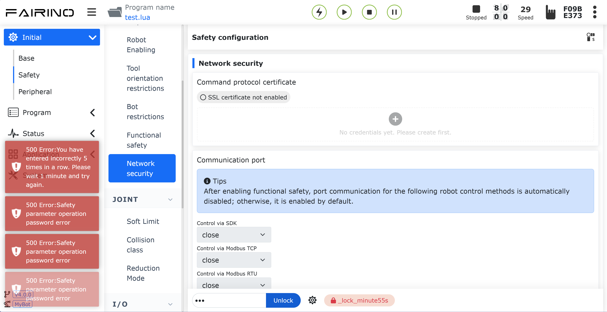

.. centered:: Figura 7.3-4 Bloqueio Anti-Força-Bruta da Senha de Segurança

Cibersegurança
~~~~~~~~~~~~~~~~~~~~~~~~~~~~~~~~~~~~~~~~~~~~~~~~~~~~~~~~~~~~~~~~~~~~~~~~

As funções de cibersegurança do robô incluem comunicação criptografada de protocolos de comando, desabilitação padrão de portas de comunicação não criptografadas, atualizações de software, verificação de integridade durante a inicialização, etc., que são usadas para autenticação de identidade, anti-escuta e anti-adulteração, resistência a ataques de rede e garantia de comunicação segura e controlável.

Informações sobre o ambiente de segurança de rede
+++++++++++++++++++++++++++++++++++++++++++++++++++++++++++++++++++++

Os usuários devem atender aos seguintes requisitos ambientais para garantir a eficácia das funções de segurança de rede do robô colaborativo; se o ambiente não atender aos requisitos, a capacidade de proteção de segurança do robô colaborativo poderá ser reduzida e poderão existir riscos de segurança.

Ambiente de segurança física
*******************************************************************************

① O controlador do robô e quaisquer switches por onde passar devem ser instalados em um armário de controle equipado com dispositivo de travamento. É estritamente proibido que pessoal não autorizado abra a porta do armário. Sem autorização, é proibido tocar nas portas Ethernet e nas portas de I/O de segurança do controlador ou em qualquer outra interface.

② A porta Ethernet do controlador do robô é usada apenas para conectar a um computador industrial. É proibido conectar um computador pessoal diretamente ou conectar-se à porta de rede do controlador por meio de um switch. Pessoal não autorizado está proibido de tocar no computador industrial que tenha conexão de rede com o robô. Defina uma senha de login para o computador industrial.

③ O teach pendant e a caixa de botões do robô devem ser colocados em uma área de trabalho segura. Pessoal não autorizado está proibido de entrar nessa área.

Configuração de segurança do robô
*******************************************************************************

① Defina contas de login do WebApp com as permissões correspondentes para pessoal com permissões diferentes, especialmente permissões para atualização de software/firmware e configuração de parâmetros de segurança;

② Altere a senha de login do administrador do WebApp do robô e a senha de configuração de segurança; guarde as senhas adequadamente para evitar vazamentos;

③ Ao usar a comunicação por protocolo de comando, habilite a criptografia e guarde adequadamente qualquer certificado de criptografia de comunicação de rede baixado do robô. É estritamente proibido vazar certificados.

④ Mantenha as portas de comunicação não criptografadas desabilitadas por padrão; não as habilite a menos que seja necessário.

Requisitos de versão para funções de segurança de rede
+++++++++++++++++++++++++++++++++++++++++++++++++++++++++++++++++++++

A versão de software do robô V4.0.0 e superiores suporta funções de segurança de rede. Versões de software do robô inferiores a esse número de versão não suportam funções de segurança de rede.

Criptografia de Comunicação do WebApp
+++++++++++++++++++++++++++++++++++++++++++++++++++++++++++++++++++++

A comunicação do WebApp do robô usa comunicação criptografada HTTPS TLS 1.2. Ao usar o WebApp, um certificado deve ser instalado (se o certificado não for instalado, o navegador exibirá uma conexão não segura). Os passos específicos são os seguintes:

① Insira o endereço IP do robô no navegador, como 192.168.58.2, e pressione Enter para acessar a página do WebApp do robô. Neste momento, o navegador exibirá um aviso de conexão não segura.

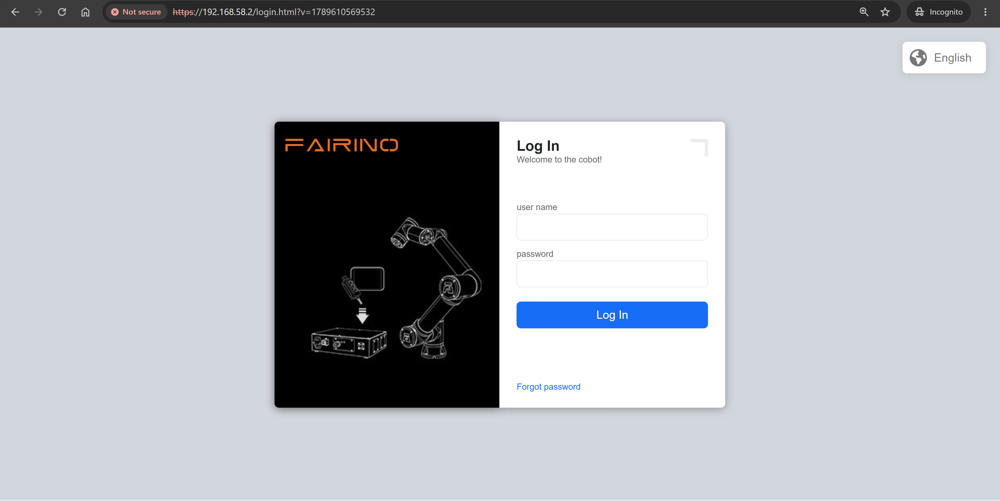

.. centered:: Figura 7.3-5 Conexão Não Segura Exibida

② Clique em "Não seguro" no lado esquerdo da caixa de entrada do endereço IP para abrir a janela de detalhes da conexão.

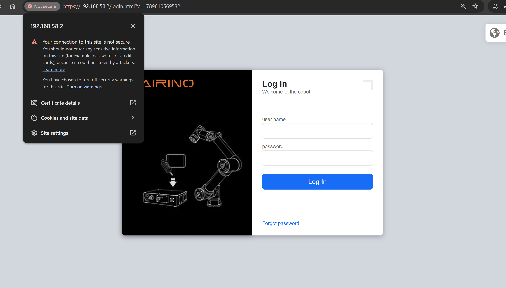

.. centered:: Figura 7.3-6 Janela de Detalhes da Conexão Aberta

③ Na janela, clique em "Detalhes do certificado" para abrir a janela de detalhes do certificado. Selecione "Detalhes" na aba superior e clique no botão "Exportar" para baixar o certificado. O nome do certificado baixado é geralmente o endereço IP do robô. Você precisa renomear o arquivo e adicionar a extensão ".crt", por exemplo, alterar "192.168.58.2" para "192.168.58.2.crt".

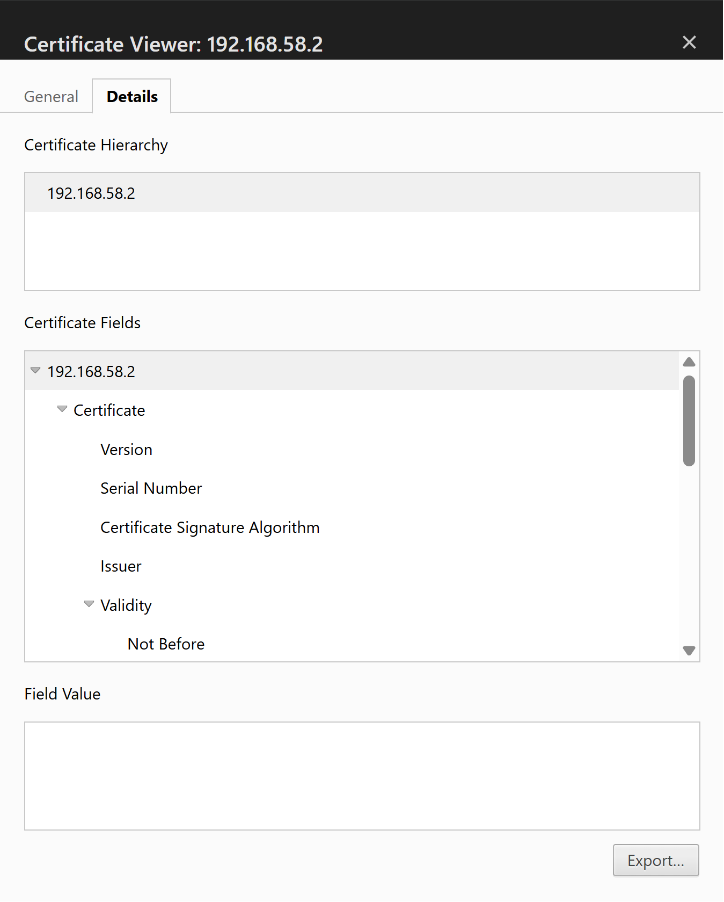

.. centered:: Figura 7.3-7 Janela de Detalhes do Certificado

.. image:: safety/053.png
   :width: 4in
   :align: center

.. centered:: Figura 7.3-8 Nome do Arquivo do Certificado

④ Dê um duplo clique no arquivo do certificado para abrir a janela de instalação do certificado e clique em "Instalar certificado".

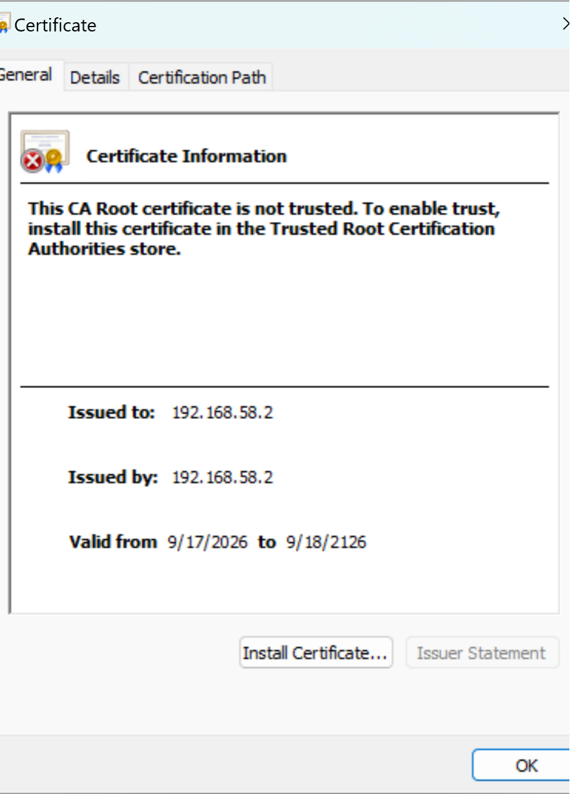

.. centered:: Figura 7.3-9 Janela de Instalação do Certificado

⑤ No assistente de instalação do certificado que aparece, selecione o local de armazenamento como Computador Local e clique em Avançar.

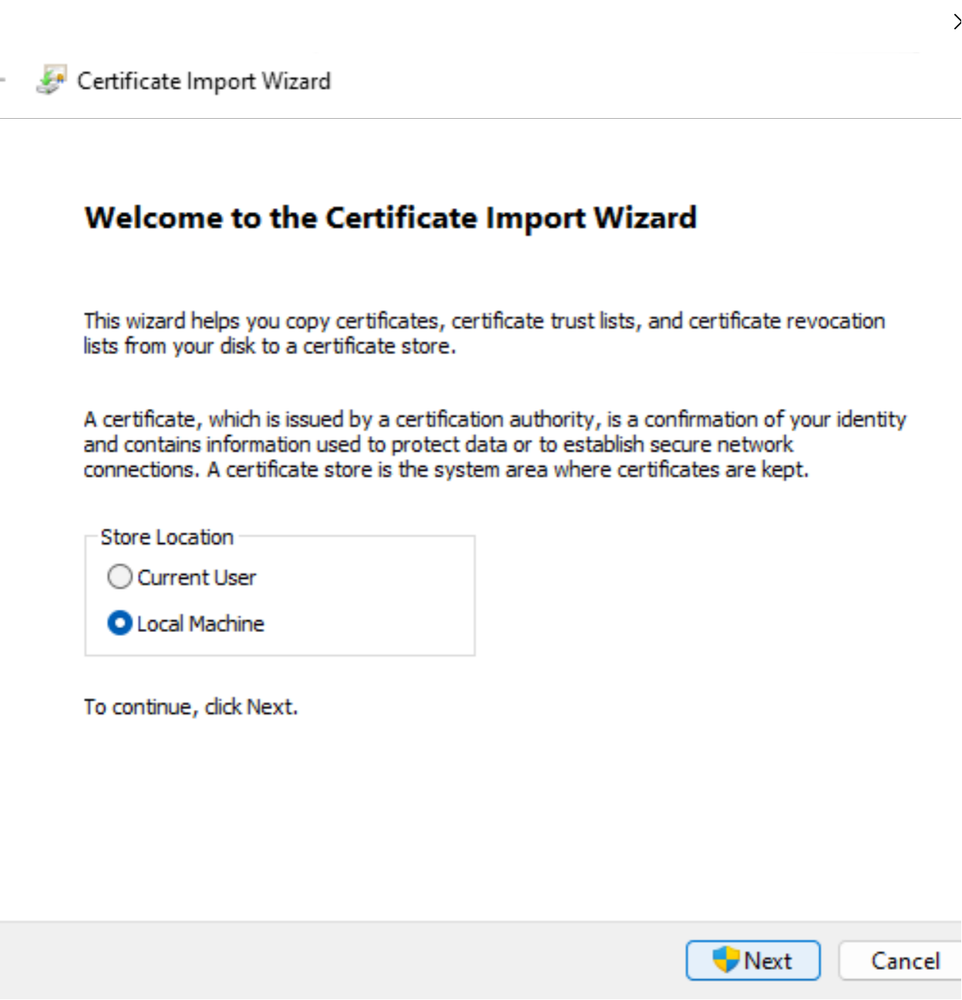

.. centered:: Figura 7.3-10 Selecionar Local de Armazenamento como Computador Local

⑥ Na janela do assistente de certificado, selecione "Colocar todos os certificados no seguinte repositório", clique no botão "Procurar" e selecione "Autoridades de Certificação Raiz Confiáveis". Clique em Avançar.

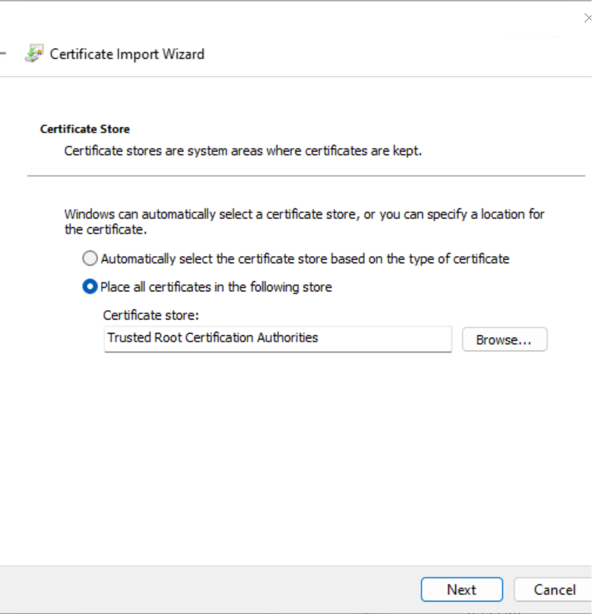

.. centered:: Figura 7.3-11 Selecionar Autoridade de Certificação Raiz Confiável

⑦ Clique em "Concluir".

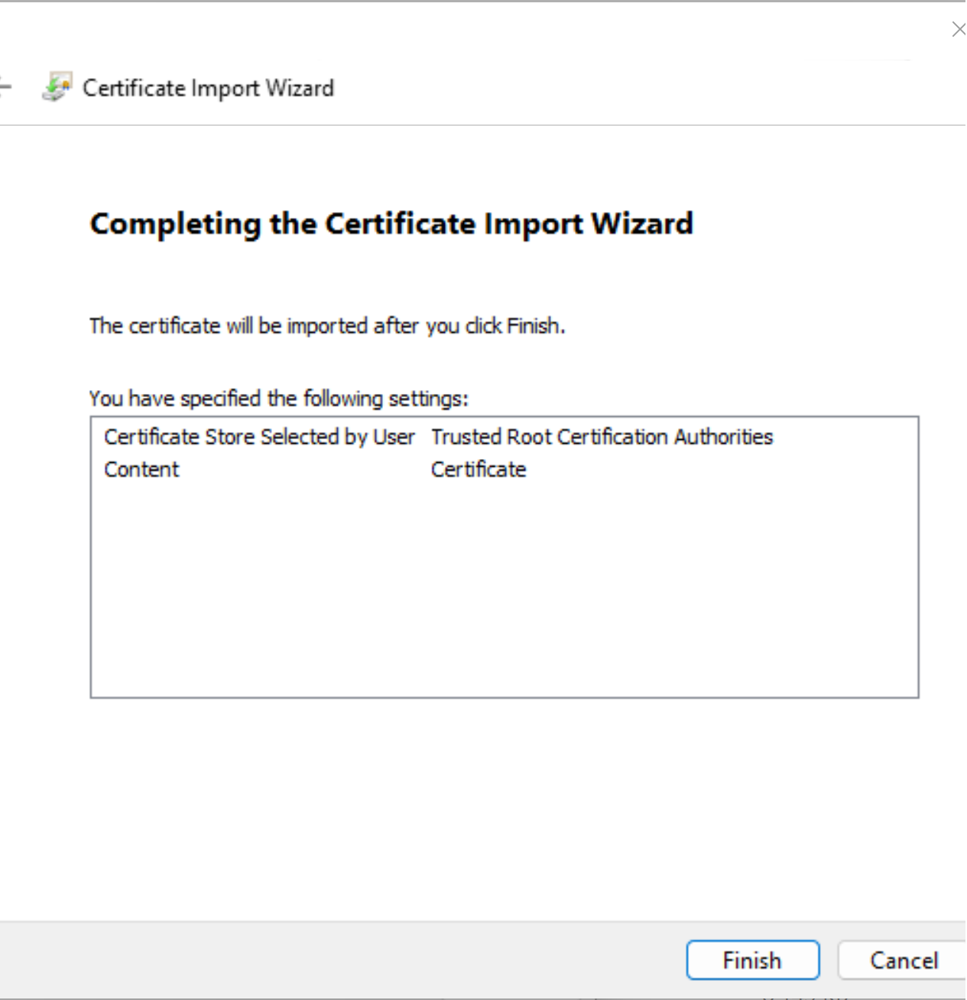

.. centered:: Figura 7.3-12 Instalação do Certificado do WebApp Concluída

Reinicie o navegador e faça login no WebApp; será exibida uma conexão segura normal.

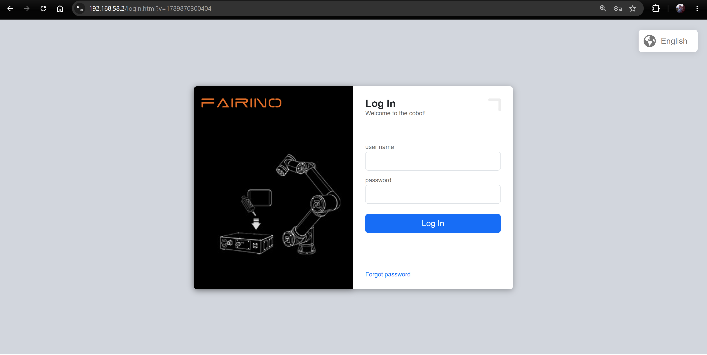

.. centered:: Figura 7.3-13 Conexão Segura Exibida Após Instalar o Certificado do WebApp

Criptografia do Protocolo de Comando
+++++++++++++++++++++++++++++++++++++++++++++++++++++++++++++++++++++

Os protocolos de comando 8080-TCP e 20007-UDP do robô podem ser configurados para se comunicar por meio de criptografia de autenticação mútua TLS 1.2. Os usuários baixam do robô o certificado raiz, o certificado do cliente e a chave privada do cliente. Cada robô possui seu próprio certificado raiz separado; certificados de cliente e chaves privadas baixados de robôs diferentes não podem ser misturados. Um único robô suporta apenas um conjunto de certificado de cliente e chave privada.

No WebApp do robô, clique em sequência em "Configuração Inicial", "Segurança", "Cibersegurança", insira a senha de segurança para desbloquear e encontre "Certificado do Protocolo de Comando" em "Cibersegurança".

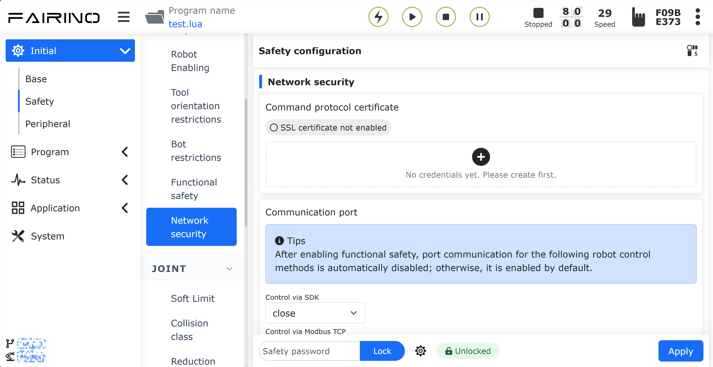

.. centered:: Figura 7.3-14 Página de Configuração do Certificado do Protocolo de Comando

Clique no botão "Nenhum certificado ainda, crie primeiro", insira o número de dias válidos do certificado do protocolo de comando a partir do dia atual. Clique no botão "Criar". Após a criação bem-sucedida do certificado, serão exibidos o nome do certificado do cliente, o número de série e a data de expiração calculada com base nos dias válidos.

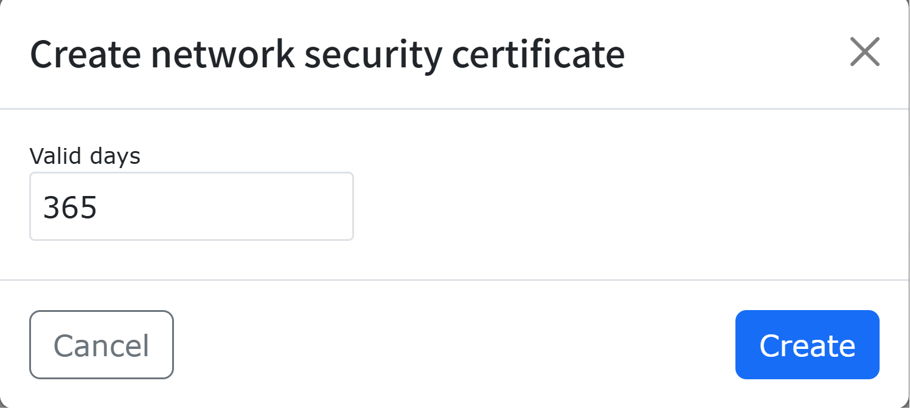

.. centered:: Figura 7.3-15 Configuração do Período de Validade do Certificado do Protocolo de Comando

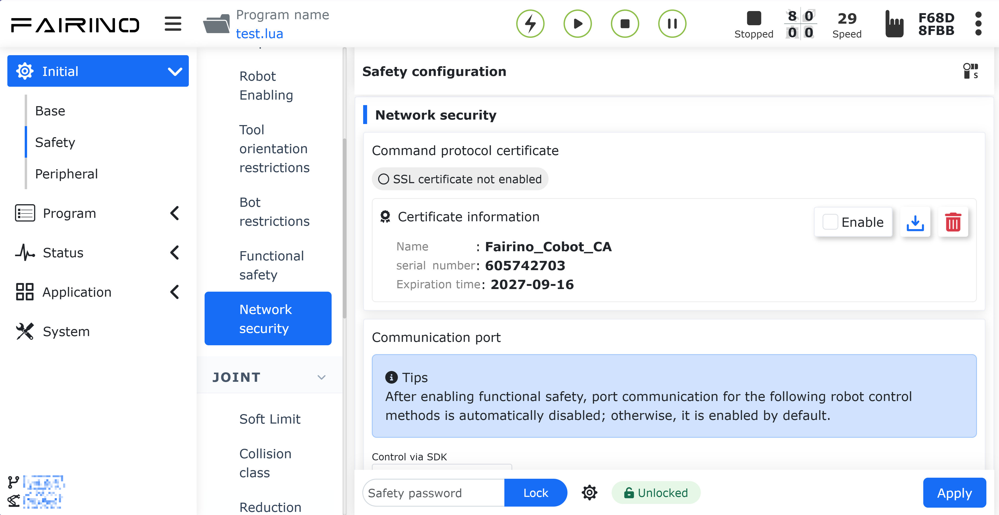

.. centered:: Figura 7.3-16 Informações do Certificado do Protocolo de Comando

Clique no botão de download à direita para baixar o arquivo "client_certs.tar.gz". O arquivo contém três arquivos: "ca.crt": certificado raiz; "client.crt": certificado do cliente; "client.key": chave do cliente.

Clique em "Habilitar" e clique no botão "Aplicar". Na janela de confirmação da configuração de segurança do robô que aparece, confirme a habilitação da criptografia do certificado do protocolo de comando e clique novamente no botão "Confirmar" para habilitar a criptografia do protocolo de comando.

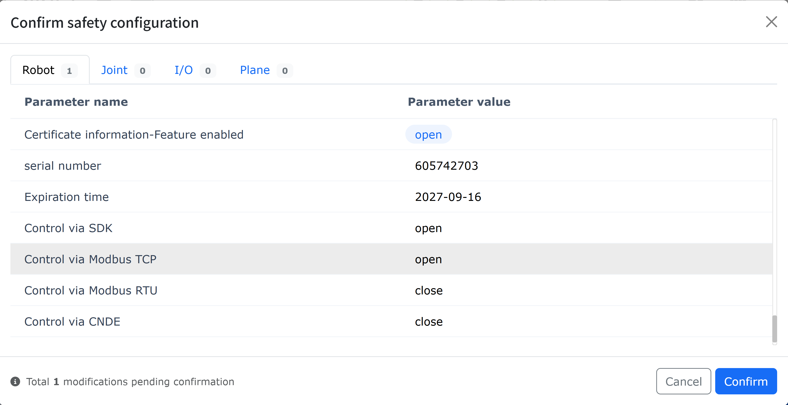

.. centered:: Figura 7.3-17 Confirmação de Habilitação do Certificado do Protocolo de Comando

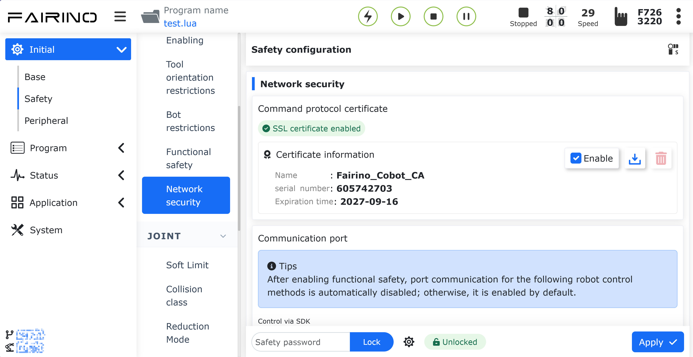

.. centered:: Figura 7.3-18 Criptografia do Certificado do Protocolo de Comando Habilitada

Clique no botão "Excluir" no lado direito da caixa de informações do certificado para desabilitar o certificado correspondente a esse número de série. Antes de excluir o certificado, a criptografia do protocolo de comando deve primeiro ser definida como desabilitada.

Configuração de Habilitação de Funções de Comunicação de Rede Não Criptografadas
++++++++++++++++++++++++++++++++++++++++++++++++++++++++++++++++++++++++++++++++++++

Algumas funções de comunicação de rede não criptografadas do robô podem ser configuradas para serem habilitadas ou desabilitadas; por padrão, ficam desabilitadas.

.. note:: Nota: a função de desabilitação das portas de comunicação do robô só entra em vigor quando a "Segurança Funcional" está habilitada. No modo que não seja "Segurança Funcional", todas as funções de comunicação de rede do robô ficam habilitadas!

No WebApp do robô, clique em sequência em "Configurações Iniciais", "Segurança" e "Segurança de Rede" e encontre "Portas de Comunicação". As funções de cada porta são descritas a seguir:

.. centered:: Figura 7.3-19 Configuração de Habilitação das Portas de Comunicação

- **Controle via SDK**: Controlar o robô através da porta de comunicação XMLRPC no SDK do robô. Quando não habilitado, o robô não pode ser controlado via XMLRPC.
- **Controle via ModbusTCP**: Quando o robô atua como escravo ModbusTCP, a saída DO do robô, início/parada do programa, comutação manual/automática, modo reduzido, etc. podem ser controlados através de "Entrada Digital Funcional (Bobina)". Após desabilitar "Controle via ModbusTCP", as funções de controle acima através de "Entrada Digital Funcional (Bobina)" são todas desabilitadas.
- **Controle via ModbusRTU**: Quando o robô atua como escravo ModbusRTU, a saída DO do robô, início/parada do programa, comutação manual/automática, modo reduzido, etc. podem ser controlados através de "Entrada Digital Funcional (Bobina)". Após desabilitar "Controle via ModbusRTU", as funções de controle acima através de "Entrada Digital Funcional (Bobina)" são todas desabilitadas.
- **Controle via CNDE**: A entrada CNDE do robô pode ser configurada para saída DO, saída AO, velocidade de execução e outros controles do robô. Após desabilitar "Controle via CNDE", o cliente CNDE não pode controlar as funções acima.
- **Função de Reset de IP da Caixa de Botões**: A caixa de botões do robô V2.0 possui um botão de reset de IP. Desabilitar a "Função de Reset de IP da Caixa de Botões" impedirá que o IP do robô seja redefinido através da caixa de botões.
- **Controle pela porta 8082**: A porta 8082 do robô é a porta de upload para arquivos LUA e arquivos de registro de trajetória TPD. Por essa porta, o conteúdo e o nome do arquivo LUA do movimento atual podem ser modificados. Quando a configuração não está habilitada, o robô não responderá às solicitações de modificação de arquivo do cliente.
- **Controle via NTP**: A caixa de controle versão LA possui um serviço de sincronização de horário NTP. Desabilitar esta função proíbe o robô de realizar sincronização de horário NTP.
- **Controle via DHCP**: Quando desativado, o robô desabilita o serviço DHCP.

Insira a senha de segurança na página de configuração de segurança e desbloqueie-a, defina as portas de comunicação a serem habilitadas como "Ligado", clique em "Aplicar", confirme as funções habilitadas na janela de confirmação da configuração de segurança que aparece e clique no botão "Confirmar".

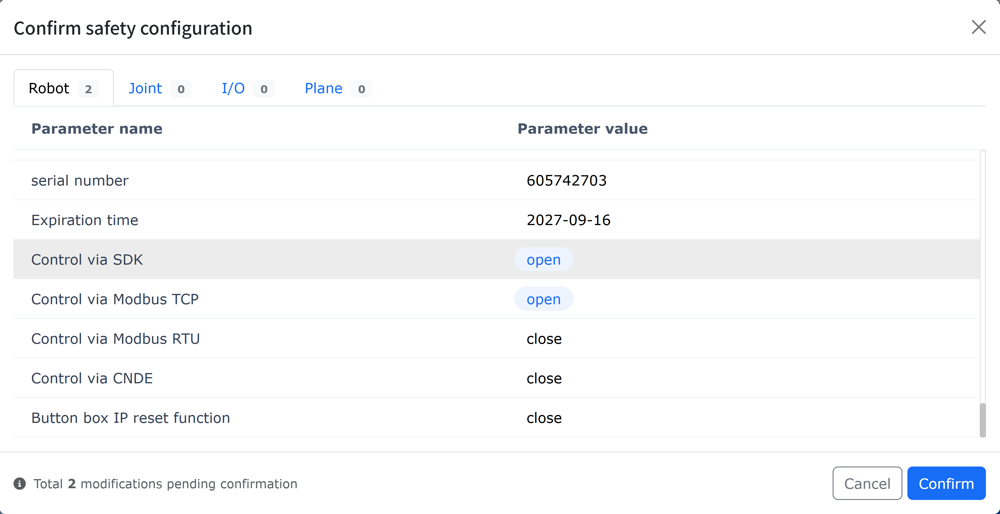

.. centered:: Figura 7.3-20 Confirmação de Habilitação das Portas de Comunicação

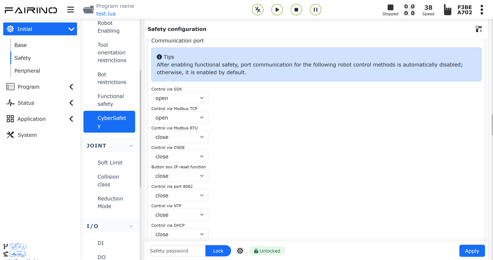

.. centered:: Figura 7.3-21 Portas de Comunicação Habilitadas

Configuração de ativação do serviço de sincronização de horário PTP do robô
++++++++++++++++++++++++++++++++++++++++++++++++++++++++++++++++++++++++++++++++++++++++++
O serviço de sincronização de horário PTP do robô pode ser configurado como desabilitado, sincronização de horário por software ou sincronização de horário por hardware, e as portas de rede Eth0 e Eth1 da caixa de controle do robô para o serviço de sincronização de horário PTP podem ser definidas. As funções "Registro de log" e "Detecção de precisão de sincronização" ainda não estão disponíveis.

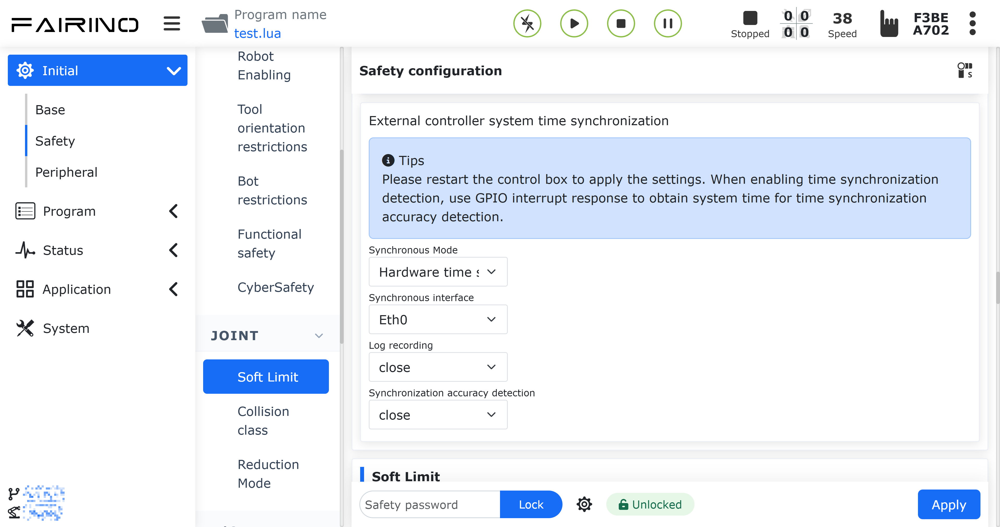

.. centered:: Figura 7.3-21-1 Configuração do serviço de sincronização de horário PTP do robô

Proteção física contra adulteração da caixa de controle do robô
++++++++++++++++++++++++++++++++++++++++++++++++++++++++++++++++++++++++++++++++++++++++++
A caixa de controle do robô possui um selo físico contra adulteração. Os usuários precisam verificar regularmente se o selo contra adulteração na caixa de controle do robô está normal.

Verificação de Integridade do Software do Robô
+++++++++++++++++++++++++++++++++++++++++++++++++++++++++++++++++++++

A atualização de software do robô e a inicialização de software executarão a verificação de integridade do pacote de software para impedir que o pacote de software do robô seja adulterado.

Verificação de integridade da atualização de software do robô: durante a atualização de software do robô, a integridade do pacote de software a ser atualizado será verificada. Se o pacote de software estiver incompleto, uma mensagem de erro será reportada durante a atualização e a atualização será interrompida.

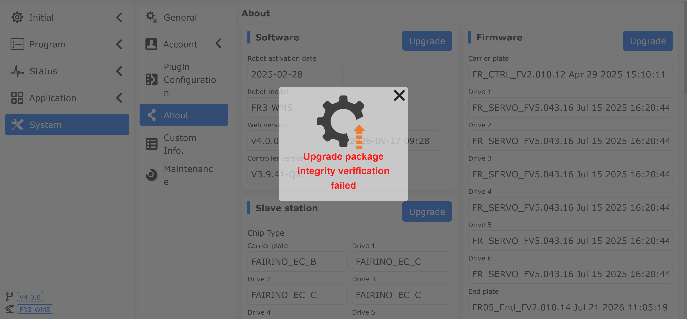

.. centered:: Figura 7.3-22 Erro de Falha na Verificação de Integridade da Atualização de Software

Verificação de integridade da inicialização de software do robô: durante a inicialização de software do robô, a integridade do pacote de software no sistema atual será verificada. Se o pacote de software estiver completo, o software do robô iniciará normalmente; caso contrário, o software do robô não iniciará, e um aviso de erro será exibido no WebApp.

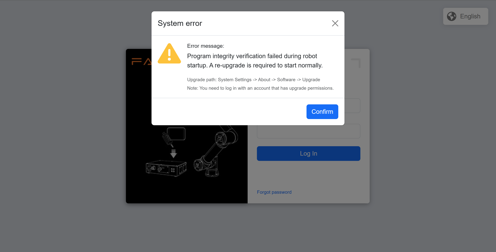

.. centered:: Figura 7.3-23 Erro de Falha na Verificação de Integridade Durante a Inicialização do Software

Declaração de Riscos Residuais de Cibersegurança
+++++++++++++++++++++++++++++++++++++++++++++++++++++++++++++++++++++

.. centered:: Tabela 2-1 Riscos Residuais de Cibersegurança e Medidas Compensatórias do Usuário

.. list-table::
   :widths: 10 20 25 45
   :header-rows: 0
   :align: center

   * - **Nº**
     - **Risco Residual**
     - **Medidas de Mitigação Adotadas**
     - **Medidas Compensatórias do Usuário**

   * - 1
     - O protocolo de comunicação SDK - XMLRPC do robô é transmitido em texto simples
     - | ① A função de controle do robô via SDK está desabilitada por padrão;
       | ② O SDK integra intrinsecamente os protocolos de comando 8080-TCP e 20007-UDP, e os protocolos de comando possuem criptografia TLS 1.2; se o handshake de criptografia do protocolo de comando falhar, o SDK não poderá se conectar normalmente ao robô.
     - | ① A comunicação SDK entre o computador host e o robô deve ser implantada apenas em um ambiente de rede isolado e confiável; a conexão a redes não confiáveis não é permitida; links de rede e portas de rede devem ter proteção física para impedir acesso não autorizado;
       | ② O SDK integra a comunicação do protocolo de comando 20007-UDP e fornece a interface SendUDPFrame() para enviar quadros de comando personalizados. Ao mesmo tempo, a comunicação do protocolo de comando 20007-UDP possui criptografia DTLS. Informações sensíveis devem ser enviadas ao robô através desta interface;
       | ③ Quando não necessário, desabilite a função de controle do robô via SDK nos módulos "Segurança" e "Cibersegurança" do WebApp;

   * - 2
     - A comunicação CNDE de troca de dados configurável 20005 - TCP / 20006 - UDP do robô é transmitida em texto simples
     - | ① A função de controle do robô via CNDE está desabilitada por padrão;
     - | ① A comunicação CNDE entre o computador host e o robô deve ser implantada apenas em um ambiente de rede isolado e confiável; a conexão a redes não confiáveis não é permitida; links de rede e portas de rede devem ter proteção física para impedir acesso não autorizado;
       | ② Quando não necessário, desabilite a função de controle do robô via CNDE nos módulos "Segurança" e "Cibersegurança" do WebApp;

   * - 3
     - A comunicação ModbusTCP do robô é transmitida em texto simples
     - | ① A função de controle do robô via ModbusTCP está desabilitada por padrão;
     - | ① A comunicação ModbusTCP entre o computador host e o robô deve ser implantada apenas em um ambiente de rede isolado e confiável; a conexão a redes não confiáveis não é permitida; links de rede e portas de rede devem ter proteção física para impedir acesso não autorizado;
       | ② Quando não necessário, desabilite a função de controle do robô via ModbusTCP nos módulos "Segurança" e "Cibersegurança" do WebApp;

   * - 4
     - A comunicação ModbusRTU do robô é transmitida em texto simples
     - | ① A função de controle do robô via ModbusRTU está desabilitada por padrão;
     - | ① A comunicação ModbusRTU entre o computador host e o robô deve ser implantada apenas em um ambiente de rede isolado e confiável; a conexão a redes não confiáveis não é permitida; links de rede e portas de rede devem ter proteção física para impedir acesso não autorizado;
       | ② Quando não necessário, desabilite a função de controle do robô via ModbusRTU nos módulos "Segurança" e "Cibersegurança" do WebApp;

   * - 5
     - Atacantes podem usar a conta e senha de login padrão do administrador do WebApp para modificar os parâmetros de configuração de segurança do robô
     - Não
     - | ① Os usuários devem modificar a senha de login padrão do administrador do WebApp do robô e guardar a senha adequadamente;
       | ② Os usuários devem definir contas e senhas de login do WebApp correspondentes para pessoal com diferentes permissões de configuração de segurança e guardar as senhas adequadamente;

   * - 6
     - Atacantes podem usar a conta e senha de login padrão do WebApp para modificar a versão de software/firmware do robô
     - Não
     - | ① Os usuários devem modificar a senha de login padrão do administrador do WebApp do robô e guardar a senha adequadamente;
       | ② Os usuários devem definir contas e senhas de login do WebApp correspondentes para pessoal com diferentes permissões de atualização de software/firmware e guardar as senhas adequadamente;

   * - 7
     - Atacantes podem usar a senha de segurança padrão para modificar parâmetros de configuração de segurança
     - Não
     - | ① Os usuários devem modificar a senha de segurança do robô; é proibido usar a senha de segurança padrão;

   * - 8
     - Atacantes podem danificar fisicamente as portas Ethernet LAN1 / LAN2 do robô, causando falha na comunicação Ethernet do robô
     - Nenhuma
     - | ① Os usuários devem instalar a caixa de controle do robô em um armário de controle com dispositivo de travamento e proibir pessoal não autorizado de tocar na caixa de controle do robô;

   * - 9
     - Atacantes podem danificar fisicamente a porta de comunicação RS-485 do robô, causando falha no controle de eixos estendidos e na comunicação ModbusRTU do robô
     - Nenhuma
     - | ① Os usuários devem instalar a caixa de controle do robô em um armário de controle com dispositivo de travamento e proibir pessoal não autorizado de tocar na caixa de controle do robô;

   * - 10
     - Atacantes podem danificar fisicamente o botão de parada de emergência na caixa de botões do robô, causando falha no botão de parada de emergência do robô
     - Nenhuma
     - | ① Os usuários devem colocar a caixa de botões do robô em uma área de trabalho segura e proibir pessoal não autorizado de entrar na área;

   * - 11
     - Atacantes podem danificar fisicamente o botão de parada de emergência no teach pendant do robô, causando falha no botão de parada de emergência do robô
     - Nenhuma
     - | ① Os usuários devem colocar o teach pendant do robô em uma área de trabalho segura e proibir pessoal não autorizado de entrar na área;

Parâmetros de Configuração de Segurança
--------------------------------------------------------------------------------------------------

Parâmetros de Segurança do Robô
~~~~~~~~~~~~~~~~~~~~~~~~~~~~~~~~~~~~~~~~~~~~~~~~~~~~~~~~~~~~~~~~~~~~~~~

Velocidade do Robô
++++++++++++++++++++++++++++++++++++++++++++++++++++++++++++++

Clique na barra de menu "Configuração Inicial" -> "Segurança" e clique no submenu "Velocidade do Robô" para entrar na interface de configuração.

A velocidade do robô é usada para limitar a velocidade linear máxima, a aceleração linear e a aceleração angular das juntas do robô.

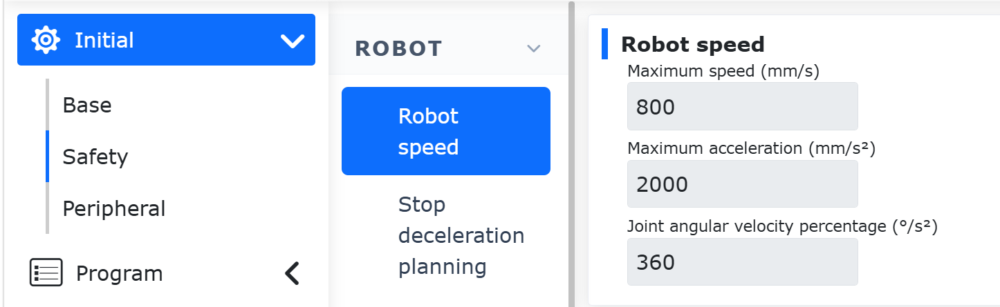

.. centered:: Figura 7.4-1 Velocidade do Robô
 
Planejamento de Desaceleração de Parada
++++++++++++++++++++++++++++++++++++++++++++++++++++++++++++++

Clique na barra de menu "Configuração Inicial" -> "Segurança" e clique no submenu "Planejamento de Desaceleração de Parada" para entrar na interface de configuração.

- Parada Livre: Ao entrar em parada, a velocidade angular de cada eixo desacelera e para de acordo com a porcentagem de desaceleração de parada definida multiplicada pela aceleração máxima da junta;
- Parada Sincronizada: Ao entrar em parada, a velocidade de pose TCP desacelera e para de acordo com a porcentagem de desaceleração de parada definida multiplicada pela aceleração máxima de pose;

A desaceleração de parada é uma porcentagem da aceleração.

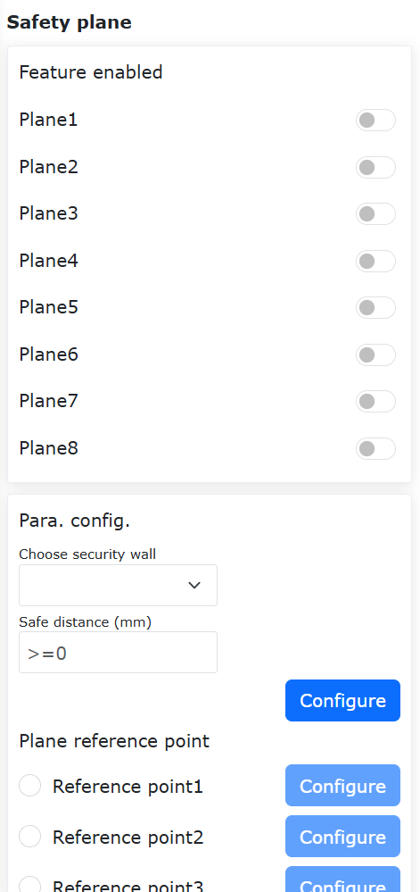

.. centered:: Figura 7.4-2 Planejamento de Desaceleração de Parada do Robô

Parada de Segurança
++++++++++++++++++++++++++++++++++++++++++++++++++++++++++++++

Clique na barra de menu "Configuração Inicial" -> "Segurança" e clique em "Parada de Segurança" para entrar na interface de configuração para definir o modo de parada de segurança e os parâmetros da estratégia de parada de segurança.

Modo de parada de segurança
**********************************************************************

Quando o modo de parada de segurança é selecionado como "Certificação CR", este modo atende principalmente aos requisitos de segurança do sistema nacional de certificação de robôs (Certificação CR) e é adequado para aceitação de projetos nacionais ou cenários de acesso ao mercado. A Certificação CR é uma certificação autoritativa para produtos robóticos chineses lançada sob a orientação de vários ministérios e comissões nacionais, com foco na avaliação da segurança e confiabilidade dos robôs.

Neste modo, a função de parada de segurança do sistema é configurada e verificada de acordo com as especificações do setor de robôs colaborativos nacionais. Na prática do setor de robôs colaborativos, tais funções de segurança essenciais geralmente são projetadas e avaliadas com referência a um nível de segurança funcional mais elevado, para garantir segurança absoluta durante a colaboração humano-robô.

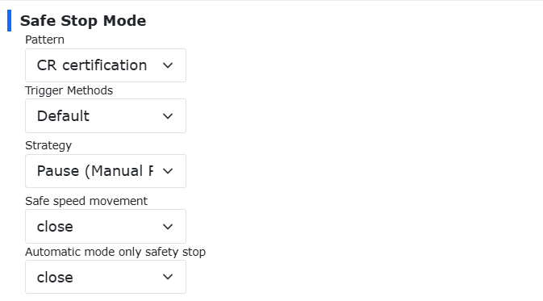

.. centered:: Figura 7.4-2-1 Modo de certificação CR

A Segurança Funcional (Functional Safety) é uma metodologia de engenharia aceita internacionalmente, cujo objetivo principal é garantir que o sistema possa entrar de forma confiável em um estado seguro quando ocorrer uma falha. Para robôs colaborativos, a segurança funcional geralmente é avaliada de acordo com ISO 13849-1 (Partes relacionadas à segurança de sistemas de controle para segurança de máquinas) & 10218, etc., para determinar o nível de desempenho dos sistemas de controle relacionados à segurança.

Quando o modo "Segurança Funcional" é selecionado, a implementação e verificação da função de parada de segurança seguem o sistema internacional de normas de segurança funcional. Este modo é adequado para exportação de produtos (como conformidade com a Diretiva de Máquinas na certificação CE da UE) ou cenários em que o cliente tenha uma base clara de normas internacionais para segurança intrínseca.

.. note:: Nota: após a configuração bem-sucedida do modo de segurança funcional, a caixa de controle precisa ser reiniciada para que as alterações de parâmetros do sistema de controle de segurança entrem em vigor.

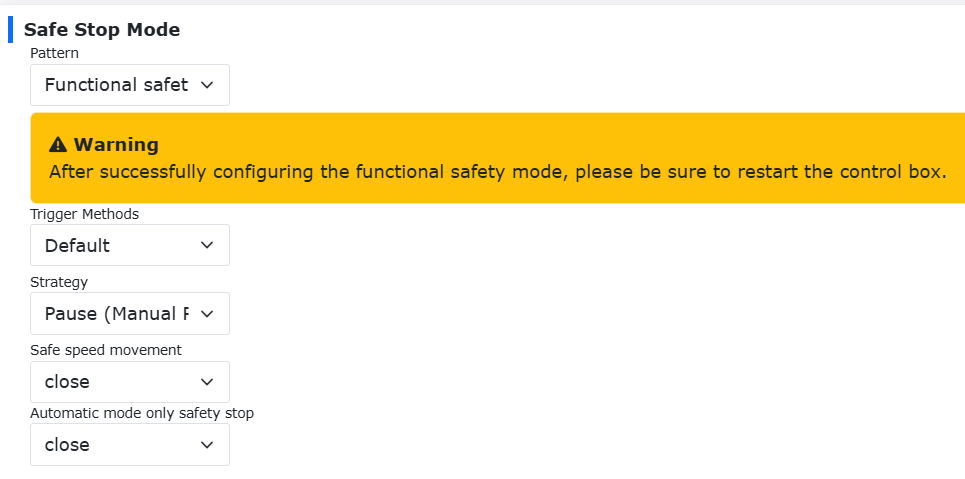

.. centered:: Figura 7.4-2-2 Modo de segurança funcional

Método de acionamento
**********************************************************************

Quando o modo de acionamento da parada de segurança está definido como "Dois Canais", ambos os canais devem ser limpos e o aviso deve ser limpo manualmente na interface de operação antes que o robô possa ser reiniciado. Além disso, uma opção de modo reduzido foi adicionada na configuração da estratégia. Quando o usuário seleciona esta estratégia, o robô entrará em movimento em modo reduzido.

**Passo 1**: Clique em "Configuração Inicial" -> "Segurança" -> "Parada de Segurança". O modo de acionamento pode ser selecionado como "Padrão" ou "Dois Canais". A diferença entre os dois é: no modo "Padrão", o erro da interface é automaticamente limpo após o acionamento e recuperação; no modo "Dois Canais", o erro da interface deve ser limpo manualmente após o acionamento e recuperação. "Estratégia de Parada de Segurança" pode ser selecionada como "Parar", "Pausar", "Modo Reduzido Nível 1" e "Modo Reduzido Nível 2". As descrições detalhadas são as seguintes: quando "Parar" é selecionado, o robô interromperá o movimento atual; quando "Pausar" é selecionado, o robô pausará o movimento atual, e após a recuperação e limpeza do erro, retomará a pausa; quando "Modo Reduzido Nível 1" é selecionado, o robô entrará em movimento em modo reduzido nível 1; quando "Modo Reduzido Nível 2" é selecionado, o robô entrará em movimento em modo reduzido nível 2.

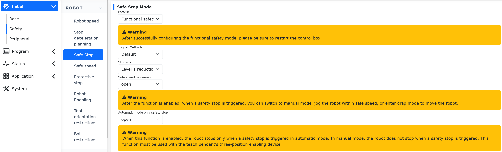

.. centered:: Figura 7.4-3 Planejamento de Desaceleração de Parada do Robô

**Passo 2**: Quando o modo de acionamento está definido como "Padrão", o erro da interface pode ser automaticamente limpo após a recuperação do acionamento. Quando o modo de acionamento está definido como "Dois Canais", a operação é: após a recuperação do acionamento, clique manualmente em "Limpar" no canto superior direito para reiniciar o robô.

Velocidade de Segurança
++++++++++++++++++++++++++++++++++++++++++++++++++++++++++++++

Clique na barra de menu "Configuração Inicial" -> "Segurança" e clique em "Velocidade de Segurança" para entrar na interface de configuração para definir a velocidade de segurança. A faixa de velocidade manual TCP é 1-1500mm/s.

A função de velocidade de segurança do robô é usada em ambientes colaborativos homem-robô ou dinâmicos para limitar ativamente a velocidade operacional do robô, controlando a energia cinética e a força de impacto dentro dos limites de segurança, prevenindo assim lesões em pessoal em caso de contato acidental e protegendo efetivamente equipamentos e peças de danos por colisão.

**Passo 1**: Clique em "Configuração Inicial" -> "Segurança" -> "Velocidade de Segurança" para definir os parâmetros de velocidade de segurança, principalmente três partes: "Habilitar Função", "Limite de Velocidade" e "Modo Pós-Excesso de Velocidade".

Entre eles, Habilitar Função pode ser selecionado como "Desabilitar", "Habilitar no Modo Manual" e "Habilitar em Todos os Modos";

Em Limite de Velocidade, defina o limite de velocidade. Quando a velocidade linear do robô atinge esse limite, ela será processada de acordo com os parâmetros definidos em "Modo Pós-Excesso de Velocidade". "Modo Pós-Excesso de Velocidade" pode ser selecionado como "Parar e Alarmar", "Limitação Automática de Velocidade" e "Desabilitar Após Parar e Alarmar". A limitação automática de velocidade está disponível apenas em "Habilitar no Modo Manual".

Após definir os parâmetros necessários, nenhuma operação adicional é necessária. O movimento do robô será processado de acordo com os parâmetros definidos. As configurações de parâmetros são mostradas na figura.

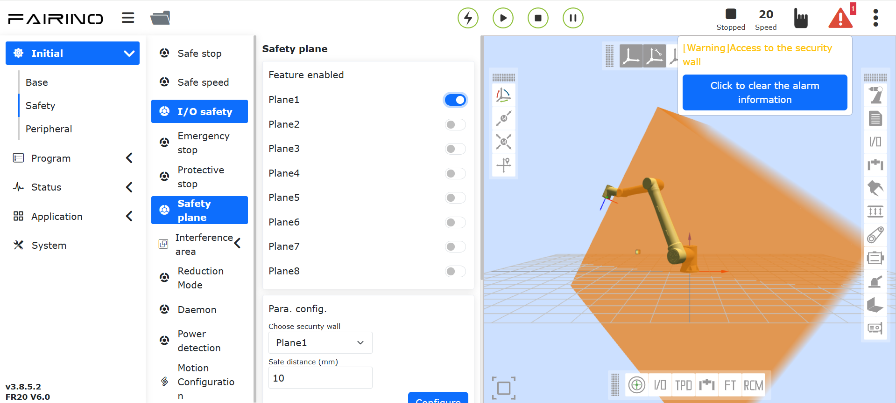

.. centered:: Figura 7.4-4 Configurações de Parâmetros de Velocidade de Segurança

Parada de Emergência
++++++++++++++++++++++++++++++++++++++++++++++++++++++++++++++

Clique na barra de menu "Configuração Inicial" -> "Segurança" e clique em "Parada de Emergência" para entrar na interface de configuração.

Os tipos de parada de emergência 0, 1a, 1b, 2 podem ser definidos, o limite de tempo de parada pode ser definido e o limite de distância de parada pode ser definido.

Através do controlador enviando para a placa da caixa de controle, a parada de emergência tipo 0 interrompe diretamente a alimentação da placa da caixa de controle;

- Parada de emergência tipo 1a: após a parada com desaceleração, interrompe a alimentação do corpo do robô;
- Parada de emergência tipo 1b: após a parada com desaceleração, não interrompe a alimentação do corpo do robô, mas desabilita o corpo do robô;
- Parada de emergência tipo 2: quando a parada de emergência é acionada, o robô desacelera até parar e permanece habilitado. Após liberar a parada de emergência, o robô deve ser capaz de operar normalmente.

.. note:: Nota: a parada de emergência só é suportada por hardware de tensão ampla.

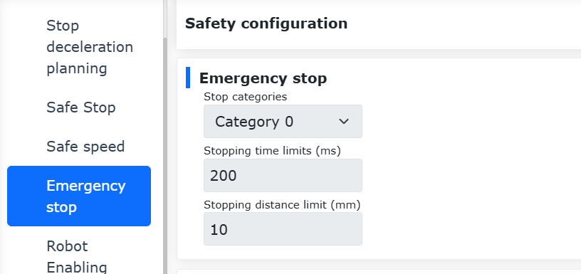

.. centered:: Figura 7.4-5 Configurações de Parada de Emergência

Parada Protetiva
++++++++++++++++++++++++++++++++++++++++++++++++++++++++++++++

Clique na barra de menu "Configuração Inicial" -> "Segurança" e clique no submenu "Parada Protetiva" para entrar na interface de configuração.

Existem três tipos de parada de proteção: 0, 1 e 2. Em qualquer modo, a função de parada de segurança é acionada de acordo com o sinal de parada de segurança da caixa de controle, e a função de parada Cat.0, Cat.1 ou Cat.2 correspondente é executada de acordo com o nível de parada de segurança configurado. Para a parada de proteção tipo 0, a placa da caixa de controle corta a alimentação diretamente. Para a parada de proteção tipo 1, a placa da caixa de controle primeiro notifica o controlador para parar o robô, e então o controlador realimenta a placa da caixa de controle para cortar a alimentação. Para a parada de proteção tipo 2, a placa da caixa de controle notifica o controlador para parar o robô.

- Se o tipo de parada for 0, a alimentação do corpo é cortada e as juntas executam um freio de segurança;
- Se o tipo de parada for 1, uma parada em desaceleração é executada, a alimentação do corpo é cortada e as juntas executam um freio de segurança;
- Se o tipo de parada for 2, uma parada em desaceleração é executada, a alimentação do corpo é mantida e as juntas não executam freio de segurança;

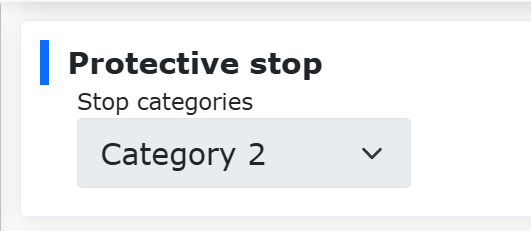

.. centered:: Figura 7.4-6 Configuração de Parada Protetiva

Habilitação Automática na Inicialização
++++++++++++++++++++++++++++++++++++++++++++++++++++++++++++++

Clique na barra de menu "Configuração Inicial" -> "Segurança" e clique no submenu "Habilitação do Robô" para entrar na interface de configuração. Você pode escolher se o robô se habilita automaticamente na inicialização ou não.

.. centered:: Figura 7.4-7 Habilitação Automática na Inicialização

Limite de Orientação da Ferramenta (Usado apenas no sistema LA)
+++++++++++++++++++++++++++++++++++++++++++++++++++++++++++++++++++++++++

Clique na barra de menu "Configuração Inicial" -> "Segurança" e clique no submenu "Limite de Orientação da Ferramenta" para entrar na interface de configuração.

O limite de orientação da ferramenta é uma função protetiva que atua no espaço cartesiano da extremidade da ferramenta do robô para limitar o intervalo de movimento da postura da extremidade do robô, incluindo a configuração de habilitação da função, a configuração da direção de referência da ferramenta e a configuração do ângulo de desvio máximo. O ângulo de desvio máximo define o valor limite angular máximo entre o eixo Z do sistema de coordenadas cartesiano da extremidade da ferramenta e a direção de referência da ferramenta, que geralmente pode ser entendido como um espaço cônico.

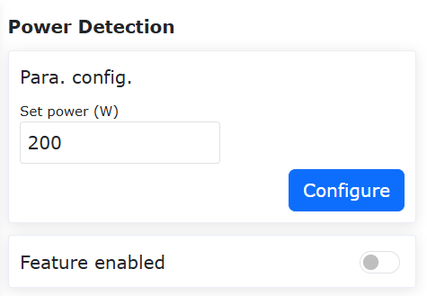

.. centered:: Figura 7.4-8 Limite de Orientação da Ferramenta

Limites do Robô (Usado apenas no sistema LA)
++++++++++++++++++++++++++++++++++++++++++++++++++++++++++++++

Clique na barra de menu "Configuração Inicial" -> "Segurança" e clique no submenu "Limites do Robô" para entrar na interface de configuração.

Os limites do robô incluem momento e potência, onde o limite de momento é usado para limitar o momento máximo do robô, e o limite de potência é usado para limitar o trabalho mecânico realizado pelo robô.

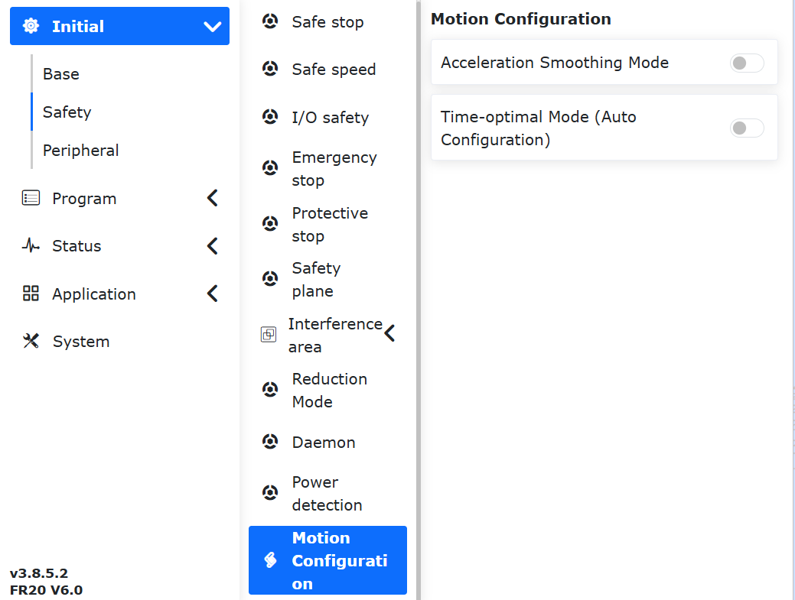

.. centered:: Figura 7.4-9 Limites do Robô

Juntas
~~~~~~~~~~~~~~~~~~~~~~~~~~~~~~~~~~~~~~~~~~~~~

Limites Suaves das Juntas
++++++++++++++++++++++++++++++++++++++++++++++++++++++++++++++

Na barra de menu "Configuração Inicial" -> "Segurança" -> "Juntas", clique em "Limites Suaves das Juntas" para entrar na interface de limites suaves.

Pode haver outros equipamentos dentro do curso de movimento do robô. Os ângulos de limite podem realizar uma limitação suave no robô, impedindo que o robô se mova além de certos valores de coordenadas e evitando colisões. O acionamento de um limite suave faz com que o robô pare automaticamente, sem distância de parada.

Os administradores podem usar valores padrão ou inserir valores de ângulo. Inserindo valores de ângulo, os ângulos positivos e negativos das juntas do robô podem ser limitados separadamente. Quando o valor inserido excede os valores de ângulo de limite suave das juntas do robô listados na tabela de parâmetros básicos do robô na Seção 2.1-Parâmetros Básicos, o ângulo de limite será ajustado para o valor máximo configurável. Quando o robô reporta um erro de comando de junta fora do limite, é necessário entrar no modo de arrasto e arrastar a junta do robô de volta para dentro do ângulo de limite.

A função de proteção de limites suaves das juntas é um mecanismo de proteção ativa que monitora o estado de movimento das juntas do braço robótico em tempo real e limita dinamicamente o operador de exceder o intervalo de limites suaves definido durante o ensino por arrasto. Esta função torna os limites suaves significativos mesmo no ensino por arrasto, aumentando assim a segurança da colaboração homem-robô.

- **Passo 1**: Faça login na interface web e clique em "Configuração Inicial" -> "Segurança" -> "Juntas" -> "Limites Suaves das Juntas" em sequência para entrar no módulo de configuração de limites suaves do robô.
- **Passo 2**: Com base na faixa de trabalho real do robô, defina razoavelmente os limites suaves para cada junta. Neste momento, verifique se a posição angular atual de cada junta do robô está dentro do intervalo de limites suaves predefinido. Se sim, clique em "Aplicar" para enviar os limites suaves predefinidos. Se não, mova cada junta para dentro do intervalo predefinido; caso contrário, um prompt de exceder limite aparecerá ao clicar em "Aplicar", como mostrado na figura abaixo. Neste momento, você pode jogar ou arrastar a junta excedente na direção do intervalo de limites suaves para limpar o erro.
- **Passo 3**: Após o intervalo de limites suaves ser definido com sucesso, selecione "Ativar" para "Proteção de Limites Suaves das Juntas" para ativar esta função, como mostrado na figura abaixo. No modo de arrasto, os limites suaves definidos terão efeito, e será sentida resistência ao arrastar perto dos limites suaves.
- **Passo 4**: Para desabilitar a função de proteção de limites suaves das juntas, clique em "Proteção de Limites Suaves das Juntas" para desligá-la.

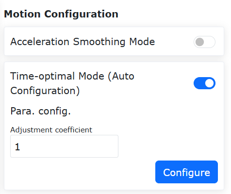

.. centered:: Figura 7.4-10 Limites Suaves das Juntas

Nível de Colisão
++++++++++++++++++++++++++++++++++++++++++++++++++++++++++++++

Na barra de menu "Configuração Inicial" -> "Segurança" -> "Juntas", clique em "Nível de Colisão" para entrar na interface de nível de colisão.
Os níveis de colisão são divididos em níveis 1 a 10. Os níveis 1 a 3 são mais sensíveis, e o robô precisa operar na velocidade recomendada. Você também pode escolher configurações de porcentagem personalizadas, com 100% correspondendo ao nível 10. Como mostrado na figura abaixo:

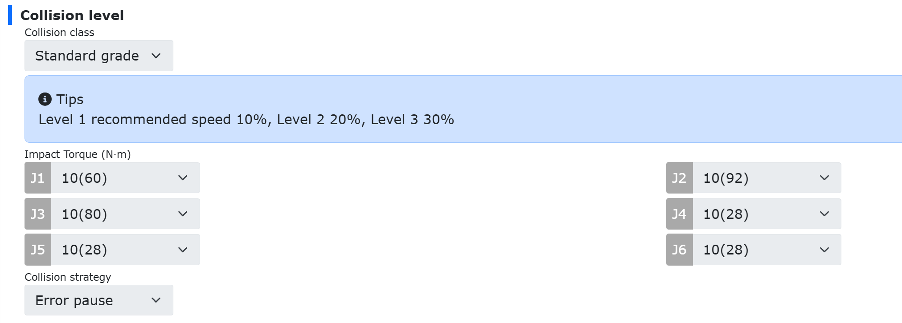

.. centered:: Figura 7.4-11 Diagrama de Nível de Colisão

As estratégias de colisão são "Parar na Colisão", "Pausar na Colisão" e "Continuar Movimento". Para evitar força de compressão entre o robô e objetos após a colisão, as estratégias "Modo de Torque de Gravidade", "Modo de Resposta Oscilante" e "Modo de Rebote de Colisão" foram adicionadas. Quando acionadas, todas as três estratégias mudarão do modo automático ou manual para o modo de arrasto, e depois de volta para o modo manual. O modo de torque de gravidade se afastará do ponto de colisão com base na magnitude e direção da força de colisão; o modo de resposta oscilante retornará à posição de colisão após se afastar; o modo de rebote de colisão acelerará para longe do ponto de colisão de acordo com os parâmetros definidos.

Na seção "Estratégia de Colisão", clique no menu suspenso para selecionar "Modo de Rebote de Colisão" e defina o tempo de segurança para 1000ms, a distância de segurança para 150mm, a velocidade de segurança para 150mm/s e o fator de segurança para cada junta para 5. A interface específica é mostrada na figura abaixo.

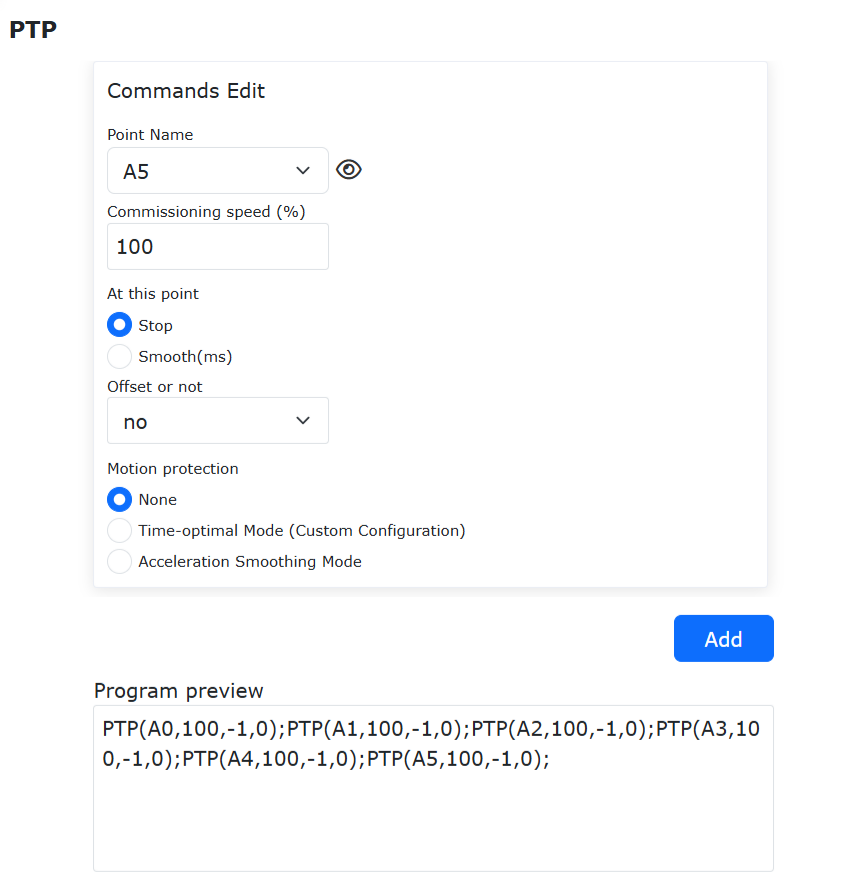

.. centered:: Figura 7.4-12 Estratégia de Colisão: Modo de Rebote de Colisão

Significado de cada parâmetro:

- Tempo de Segurança: Indica a duração no modo de arrasto após a mudança do modo automático para o modo de arrasto, intervalo [1000-2000]ms;
- Distância de Segurança: Indica a posição onde o robô se afasta do ponto de colisão após a colisão, intervalo [150-200]mm;
- Velocidade de Segurança: Indica a velocidade TCP máxima com que o robô se afasta do ponto de colisão após a colisão. Exceder este limite de velocidade restringirá a força de rebote, intervalo [50-250]mm/s;
- Fator de Segurança: Indica a taxa de decaimento da força de rebote. Quanto menor o coeficiente, mais rápido o decaimento e mais rápida a velocidade de rebote; quanto maior o coeficiente, mais lento o decaimento. Intervalo [1-10], adimensional.
- Antes de o robô entrar no modo de arrasto, é necessária a detecção de torque. Esta função é projetada para evitar fenômenos anormais como levantamento ou queda após o robô entrar no modo de arrasto devido a parâmetros de carga incorretos ou configurações de modo de instalação erradas pelo operador. Se o torque da junta for detectado fora da faixa permitida, o controlador reportará imediatamente um erro e proibirá o robô de entrar no modo de arrasto.

Passos para ativar a função de detecção de colisão para guia de cremalheira linear:

- Passo 1: Certifique-se de que tanto a guia quanto o robô estejam instalados frontalmente. Antes de ativar a função de detecção de colisão para guia de cremalheira linear, verifique se o método de instalação é frontal. Especificamente, primeiro certifique-se de que a guia e o robô estejam instalados frontalmente. Em seguida, clique em "Configuração Inicial" -> "Básico" -> "Instalação" em sequência para entrar na página de instalação livre. Se tanto "Rotação da Base" quanto "Inclinação da Base" forem 0, o software está definido como frontal; caso contrário, eles devem ser alterados para 0. Se não forem 0, a interface exibirá um erro.
- Passo 2: Ative a função de detecção de colisão para guia de cremalheira linear e defina os parâmetros. Clique em "Configuração Inicial" -> "Segurança" -> "Juntas" -> "Nível de Colisão" em sequência para entrar na página de configuração do nível de colisão. Após clicar no controle deslizante da função "Detecção de Colisão para Guia de Cremalheira Linear", defina o raio da engrenagem e a massa do cursor. O raio da engrenagem pode ser calculado a partir do avanço e da relação de redução. A massa do cursor não inclui o robô e sua carga na extremidade. Existem 11 opções de nível de guia, onde o Nível 1 é o mais fácil de acionar a colisão e o Nível 10 é o mais difícil. Quando o controlador é ligado pela primeira vez e antes que o programa de adaptação seja executado, o nível de colisão deve primeiro ser definido como "Desabilitado".

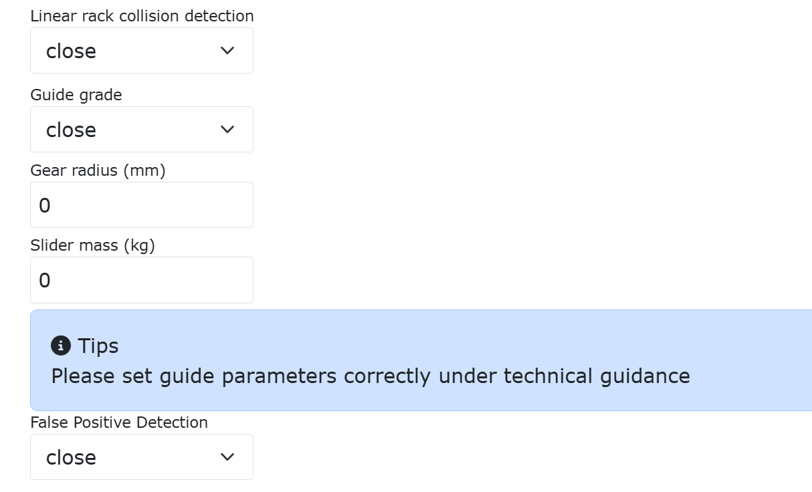

.. centered:: Figura 7.4-13 Função de Detecção de Colisão para Guia de Cremalheira Linear

- Passo 3: Execute o programa "Rail_Adaptation_Program.lua" para se adaptar à guia atual. Após cada reinicialização do controlador, o programa "Rail_Adaptation_Program.lua" deve ser executado (para evitar que mudanças no tipo de robô e outros fatores afetem as características dinâmicas da guia). Antes de executar o programa, certifique-se de que o nível de colisão da guia esteja definido como "Desabilitado". No modo automático, execute o programa LUA a 100% da velocidade da interface. Após um ciclo do programa, a adaptação está completa e a execução pode ser interrompida.

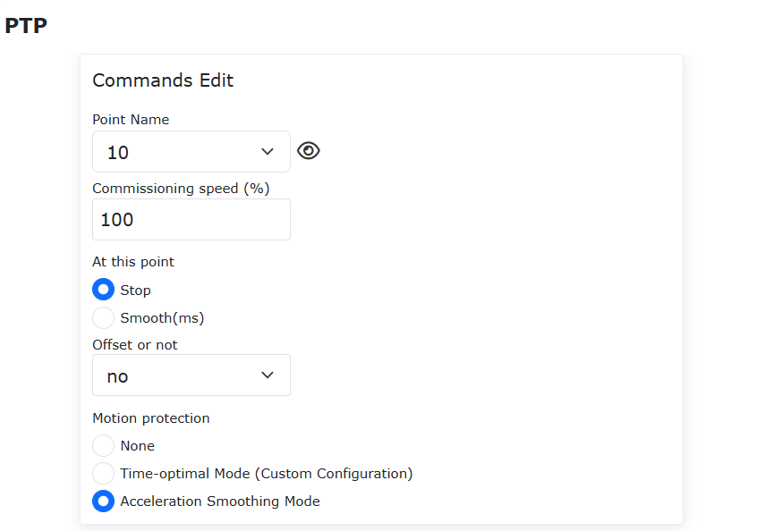

.. centered:: Figura 7.4-14 Executar "Rail_Adaptation_Program.lua" para se Adaptar à Guia Atual

- Passo 4: Defina razoavelmente o nível de colisão da guia e execute as tarefas. Os usuários podem definir razoavelmente o nível de colisão da guia com base no desempenho do acionamento do motor e na velocidade de execução da tarefa. Se a guia e o robô operam de forma assíncrona, a colisão com o robô ou a guia pode acionar uma "falha de colisão de 8 eixos, reiniciável". Neste caso, a guia para de funcionar, como mostrado na Figura 2-9. Se a guia e o robô operam de forma síncrona, a colisão com o robô pode acionar um alarme, fazendo com que a guia pare de funcionar, enquanto o robô reage de acordo com a estratégia de colisão definida.

Modo Reduzido
++++++++++++++++++++++++++++++++++++++++++++++++++++++++++++++

Clique na barra de menu "Configuração Inicial" -> "Segurança" e clique no submenu "Modo Reduzido" para entrar na interface de configuração. Selecione "Modo Nível 1/Nível 2" para configurar a velocidade das juntas e a velocidade TCP da extremidade.

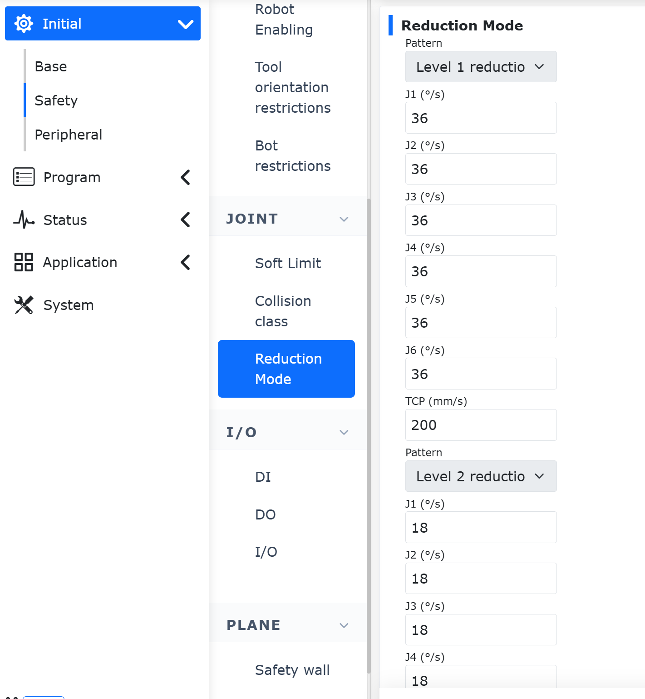

.. centered:: Figura 7.4-15 Modo Reduzido

I/O
~~~~~~~~~~~~~~~~~~~~~~~~~~~~~~~~~~~~~~~~~~~~~~~~~~~
Clique na barra de menu "Configuração Inicial" -> "Segurança" e clique no submenu "I/O" para entrar na interface de configuração.

O HMI fornece a capacidade de definir o estado de segurança para 16 entradas digitais e 16 saídas digitais, que podem ser definidas como estados válidos ou inválidos. Quando o controlador determina que está em um estado de segurança, as 16 entradas digitais e as 16 saídas digitais são definidas para o estado de segurança.

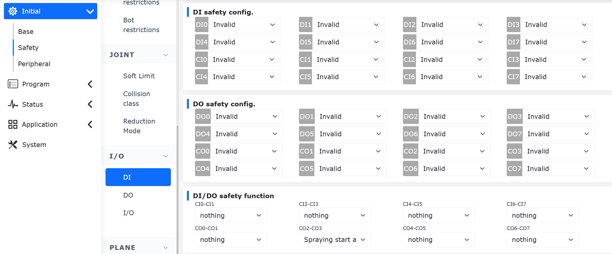

.. centered:: Figura 7.4-16 Configuração do Estado de Segurança I/O

Sob o sistema LA:

"I/O Segurança" fornece funções de segurança DIO. A função de segurança é DI ou DO de dois canais. Quando um sinal DI de segurança ou uma flag de estado de segurança é acionado, o DO é emitido.

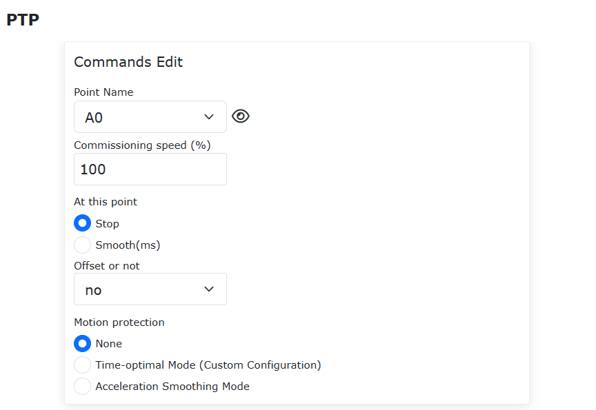

.. centered:: Figura 7.4-17 Configuração de Funções de Segurança I/O

Hardware
~~~~~~~~~~~~~~~~~~~~~~~~~~~~~~~~~~~~~~~~~~~~~~~~~~~

Detecção de Potência ServoJT (Usado apenas no sistema QX)
+++++++++++++++++++++++++++++++++++++++++++++++++++++++++++++++++++++++++++++++++++++++++++++++++++++++
Clique na barra de menu "Configuração Inicial" -> "Segurança" e clique no submenu "Detecção de Potência" para entrar na interface de configuração.

Quando atua diretamente no loop de corrente do robô (apenas com o comando servoJT), é usado para limitar a potência máxima do robô. Quando é detectado que a potência do robô excede o valor limite, a proteção de potência é executada.

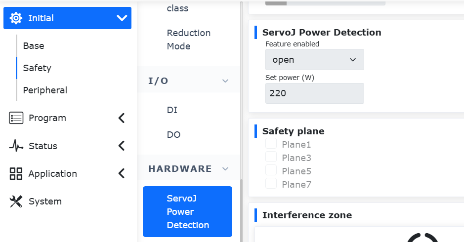

.. centered:: Figura 7.4-18 Detecção de Potência ServoJT

Planos
~~~~~~~~~~~~~~~~~~~~~~~~~~~~~~~~~~~~~~~~~~~

Parede de Segurança
+++++++++++++++++++++++++++++++++++++++++++++++++++++++++++++++++++++++++++++++++++++++++++++++++++++++

Clique na barra de menu "Configuração Inicial" -> "Segurança" e clique no submenu "Configuração de Parede de Segurança" para entrar na interface de configuração.

- Configuração de Parede de Segurança: Clique no botão Ativar para ativar a parede de segurança correspondente. Quando uma parede de segurança não foi configurada com um intervalo de segurança, um erro será exibido. Clique no botão de configuração no canto superior direito, selecione a parede de segurança que deseja definir, a distância de segurança será exibida automaticamente (opcional, padrão 0), e então clique no botão "Definir" para definir com sucesso.
- Configuração de Pontos de Referência da Parede de Segurança: Após selecionar uma parede de segurança, quatro pontos de referência podem ser definidos. Os três primeiros pontos são pontos de referência do plano, usados para confirmar o plano da parede de segurança definida. O quarto ponto é o ponto de referência do intervalo de segurança, usado para confirmar o intervalo de segurança da parede de segurança definida.

Se os pontos de referência forem definidos com sucesso, uma luz verde será exibida. Caso contrário, uma luz amarela será exibida até que os pontos de referência sejam definidos com sucesso e se tornem verdes. Quando todos os quatro pontos de referência forem definidos com sucesso, o intervalo de segurança pode ser calculado. Após o cálculo bem-sucedido, o status do ponto do parâmetro do intervalo de segurança retorna ao padrão.

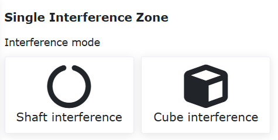

.. centered:: Figura 7.4-19 Configuração de Pontos de Referência do Intervalo de Segurança

- Efeito de Aplicação: Ative a parede de segurança configurada com sucesso. Arraste o robô. Se o TCP da extremidade do robô estiver dentro do intervalo de segurança definido, o sistema está normal. Se estiver fora do intervalo de segurança definido, um erro será exibido.

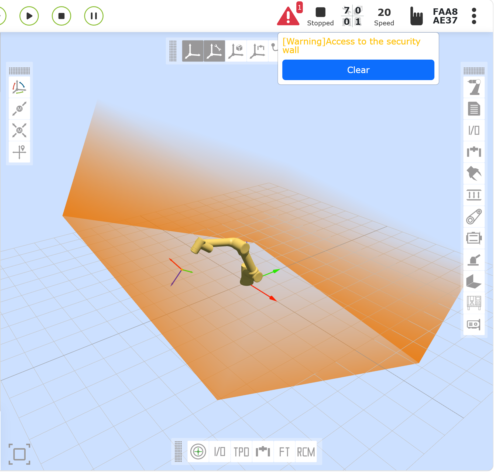

.. centered:: Figura 7.4-20 Efeito Após Configuração Bem-sucedida do Intervalo de Segurança

Zona de Interferência
+++++++++++++++++++++++++++++++++++++++++++++++++++++++++++++++++++++++++++++++++++++++++++++++++++++++

Na barra de menu "Configuração Inicial" -> "Segurança" -> "Zona de Interferência", clique no item do submenu "Individual" para entrar na interface de configuração da zona de interferência.

Precisamos configurar o método de interferência e a operação ao entrar na zona de interferência. Os métodos de interferência são divididos em "Interferência de Eixo" e "Interferência de Cuboide".

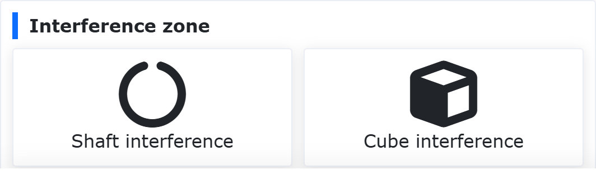

.. centered:: Figura 7.4-21 Métodos de Zona de Interferência

Clique no ícone da zona de interferência, use o interruptor para controlar se está ativado e clique no botão de configuração no canto superior direito para a configuração de parâmetros.

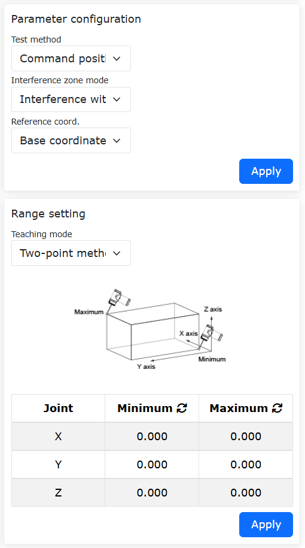

.. centered:: Figura 7.4-22 Configuração da Zona de Interferência

Primeiro, configure o movimento da zona de interferência como "Continuar Movimento" ou "Parar". Em seguida, defina a configuração de arrasto ao entrar na zona de interferência. Os usuários podem definir a estratégia após entrar na zona de interferência no modo de arrasto de acordo com suas necessidades: sem restrição de arrasto, retorno de impedância ou mudança para o modo manual.

Ao selecionar Interferência de Eixo, os parâmetros de interferência do eixo precisam ser configurados. O método de detecção pode ser "Posição de Comando" ou "Posição de Feedback". O modo da zona de interferência pode ser "Interferência Dentro do Intervalo" ou "Interferência Fora do Intervalo". Em seguida, defina o intervalo para cada junta e se o intervalo para cada junta está ativado. Você pode inserir valores ou usar o ícone "Atualizar" após "Mín" e "Máx" para registrar a posição atual do robô, e finalmente clique em Configurar.

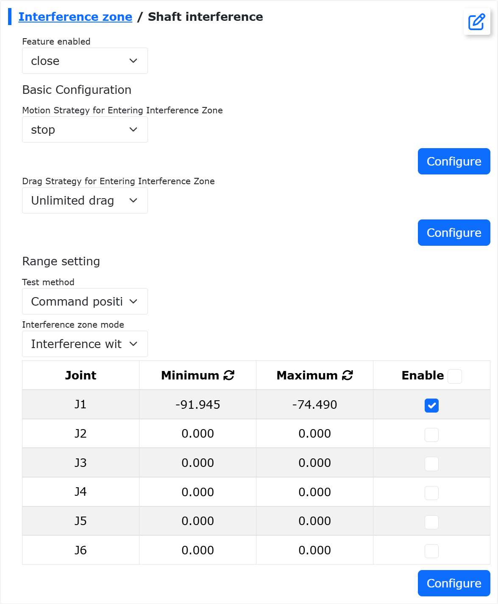

.. centered:: Figura 7.4-23 Configuração de Interferência de Eixo

Ao selecionar Interferência de Cuboide, os parâmetros de interferência do cuboide precisam ser configurados. O método de detecção pode ser "Posição de Comando" ou "Posição de Feedback". O modo da zona de interferência pode ser "Interferência Dentro do Intervalo" ou "Interferência Fora do Intervalo". O sistema de coordenadas de referência pode ser "Coordenada Base" ou "Coordenada Peça", selecionado de acordo com o uso real. Em seguida, defina o intervalo. Existem dois métodos para a definição do intervalo. O primeiro método é o "Método de Dois Pontos", que usa dois vértices diagonais do cuboide. As posições podem ser inseridas ou registradas através do ensino do robô. Finalmente, clique em Aplicar.

.. centered:: Figura 7.4-24 Configuração de Interferência de Cuboide

O segundo método é o "Método Centro + Comprimento do Lado", onde o ponto central do cuboide e o comprimento do lado do cuboide formam a zona de interferência. As posições podem ser inseridas ou registradas através do ensino do robô. Finalmente, clique em Aplicar.

.. centered:: Figura 7.4-25 Configuração de Interferência de Cuboide

Função de Armazenamento do Log de Segurança
~~~~~~~~~~~~~~~~~~~~~~~~~~~~~~~~~~~~~~~~~~~~~~~~~~~~~~~~~~~~~~~~~~~~~~~~~~~~~~~~~~~~~~~~~~~~~~~

Contexto
+++++++++++++++++++++++++++++++++++++++++++++++++++++++++

A certificação CE para robôs da série FR exige que todos os logs relacionados a operações de segurança do equipamento sejam registrados e mantidos separadamente. Também exige explicitamente que o armazenamento de logs inclua pelo menos a última evidência de intervenção para cada tipo de intervenção, que os registros de dados de rastreamento de cada intervenção sejam mantidos por pelo menos 5 anos e que os logs sejam protegidos contra adulteração.

Gerenciamento do Log de Segurança
+++++++++++++++++++++++++++++++++++++++++++++++++++++++++

O gerenciamento do log de segurança é mantido na página web em "Configuração Inicial" -> "Segurança". A "Senha de Configuração de Segurança" deve ser inserida para verificação primeiro, e o gerenciamento do log de segurança só pode ser realizado após verificação bem-sucedida.

.. centered:: Figura 7.4-26 Gerenciamento do Log de Segurança

Os logs de segurança são gerenciados uniformemente. Para evitar um volume excessivo de logs causado por operações anormais, o volume atual de armazenamento de logs pode ser visto intuitivamente na página. Os logs de segurança retêm apenas os últimos 5 anos, e os logs de cada ano são armazenados uniformemente em arquivos separados de acordo com o tipo de log. Clique em Exportar para exportar todos os logs.

Os tipos de log são divididos nas seguintes três categorias:

.. centered:: Tabela 1-2 Classificação do Log de Segurança

.. list-table::
   :widths: 30 30 40
   :header-rows: 0
   :align: center

   * - **Categoria do Log**
     - **Nome do Arquivo de Log**
     - **Descrição**

   * - Modificação de Parâmetros
     - safetylog_params_2026.log
     - Modificação de parâmetros de configuração de segurança do robô, modificação de senha de segurança do robô

   * - Versão de Software/Firmware
     - safetylog_version_2026.log
     - Atualização de versão de software/firmware

   * - Operação de Log
     - safetylog_operate_2026.log
     - Exclusão, exportação de log de segurança

Como os logs de segurança devem ser mantidos por 5 anos e não podem ser excluídos, para evitar que gravações anormais causem anomalias de memória de armazenamento que afetem a operação do sistema, os logs de segurança adotam uma estratégia de limitação de taxa em níveis baseada na capacidade usada. Antes da gravação, o espaço de log atualmente usado é verificado e a frequência de gravação é ajustada dinamicamente.

.. centered:: Tabela 1-3 Estratégia de Limitação de Taxa do Log de Segurança

.. list-table::
   :widths: 20 30 20 30
   :header-rows: 0
   :align: center

   * - **Estágio**
     - **Capacidade Usada**
     - **Frequência de Gravação**
     - **Descrição**

   * - 1
     - <500M
     - Ilimitada
     - Uso normal (cerca de 200M por 5 anos)

   * - 2
     - 500M-1G
     - 1 segundo/entrada
     - Limitação leve, sem impacto na experiência

   * - 3
     - 1G-2.5G
     - 5 segundos/entrada
     - Anomalia óbvia, redução proativa de velocidade

   * - 4
     - 2.5G-4G
     - 30 segundos/entrada
     - Anomalia grave, tempo de atraso extremo

   * - 5
     - >4G
     - Parar gravação
     - Cota esgotada, sem mais gravação de log

Em uso normal, com um volume de gravação de 1000 entradas por dia, o uso estimado em 5 anos fica dentro de 200M. Portanto, quando a memória excede 1G, há claramente uma situação anormal. Após exceder 1G, o controlador reportará proativamente um aviso. É necessário exportar e fazer backup dos logs proativamente e recomenda-se a limpeza oportuna dos logs.

.. centered:: Figura 7.4-27 Aviso de Anomalia do Log de Segurança

O tempo de exportação do log depende do tamanho total do log. Teoricamente, o volume total de log em 5 anos não excederá 200M. Quando os logs excedem 1G, o tempo de download excede 1 minuto, e no limite superior de 4G, o tempo de download é de cerca de 5 minutos. Após a exportação, a limpeza de logs pode ser realizada. Para garantir que evidências anormais não sejam limpas, a função de exclusão de log atual exclui apenas logs de anos diferentes do ano atual.

.. centered:: Figura 7.4-28 Exclusão do Log de Segurança

Funções de segurança funcional
----------------------------------------------------------------

Descrição da segurança funcional
~~~~~~~~~~~~~~~~~~~~~~~~~~~~~~~~~~~~~~~~~~~~~~~~~~~~~~~~~~~~~~~~~

Este dispositivo está equipado com um sistema de controle relacionado à segurança, usado para executar automaticamente ações de segurança (como parada de emergência, intertravamento da porta de proteção, etc.) quando uma situação perigosa é detectada. Essas funções de segurança foram projetadas e verificadas em conformidade com as normas EN ISO 13849-1 / EN IEC 62061 e são uma parte importante para alcançar a conformidade CE.

Para garantir que as funções de segurança permaneçam eficazes, observe:

- Não contorne ou mascare qualquer dispositivo de segurança (como remover interruptores de intertravamento, curto-circuitar circuitos de segurança, obstruir cortinas de luz, etc.), caso contrário, pode causar graves ferimentos pessoais.
- Não modifique componentes ou programas de software relacionados à segurança sem autorização. Qualquer modificação, alteração de parâmetros ou atualização de software no sistema de controle de segurança deve ser executada pelo fabricante ou por pessoal autorizado, e uma avaliação de risco deve ser realizada novamente.
- Segurança de rede: não conecte o sistema de controle de segurança deste dispositivo a uma rede não autorizada; o acesso digital não autorizado pode causar falha nas funções de segurança.
- Manutenção e falhas: se qualquer dispositivo de segurança operar de forma anormal ou falhar, pare a máquina imediatamente e entre em contato com o fabricante ou pessoal de serviço autorizado. Apenas pessoal treinado e autorizado pode executar manutenção.

Este dispositivo é submetido à avaliação de conformidade de acordo com o Regulamento de Máquinas da UE (UE) 2023/1230. Os componentes das funções de segurança estão listados na documentação técnica para referência. A seguir está a lista específica de funções de segurança.

.. centered:: Tabela 1-1  Lista de funções de segurança

.. list-table::
   :widths: 20 20 10 40 10
   :header-rows: 0
   :align: center

   * - **ID SF**
     - **Nome da função**
     - **Nível**
     - **Descrição**
     - **MTTFd***

   * - SF01
     - E-STOP on TPU-Parada de emergência no teach pendant
     - PL d
     - | Execution monitoring of the emergency stop-Monitoramento da execução da parada de emergência
       | Inclui lógica de acionamento para diferentes fontes de acionamento:
       | 1. Em qualquer modo, quando o interruptor de parada de emergência do teach pendant é acionado, ele é convertido em um sinal de parada de emergência da caixa de controle, e a ação de parada Cat.0 ou Cat.1 é executada de acordo com o tipo configurado, com função de manutenção de posição intertravada
       | 2. Em qualquer modo, quando o DI de segurança da caixa de controle é acionado, ele é convertido em um sinal de parada de emergência da caixa de controle, e a ação de parada Cat.0 ou Cat.1 é executada de acordo com o tipo configurado, com função de manutenção de posição intertravada
       | [Evento de acionamento]: Sinal de parada de emergência acionado
       | [Resposta do robô]:
       | Se o tipo de parada for 0, a alimentação do corpo é cortada, as juntas executam um freio de segurança e a manutenção de posição é monitorada
       | Se o tipo de parada for 1, uma parada em desaceleração é executada, a alimentação do corpo é cortada, as juntas executam um freio de segurança e a manutenção de posição é monitorada	
     - 202.051

   * - SF02
     - Safeguard Stop-Parada de proteção
     - PL d
     - | Execution monitoring of the safeguard stop-Monitoramento da execução da parada de proteção
       | Em qualquer modo, a função de parada de segurança é acionada de acordo com o sinal de parada de segurança da caixa de controle. De acordo com o nível de parada de segurança configurado, as funções de parada Cat.0, Cat.1, Cat.2 correspondentes e a detecção correspondente da função de manutenção de posição intertravada (Cat.0, Cat.1) ou detecção de repouso + distância de parada + tempo de parada (Cat.2) são executadas.
       | [Evento de acionamento]: Sinal de parada de segurança acionado;
       | [Resposta do robô]:
       | Se o tipo de parada for 0, a alimentação do corpo é cortada, as juntas executam um freio de segurança e a manutenção de posição é monitorada;
       | Se o tipo de parada for 1, uma parada em desaceleração é executada, a alimentação do corpo é cortada, as juntas executam um freio de segurança e a manutenção de posição é monitorada;
       | Se o tipo de parada for 2, uma parada em desaceleração é executada, a alimentação do corpo é mantida, as juntas não executam freio de segurança e permanecem habilitadas, e são executadas detecção de repouso + distância de parada + tempo de parada;	
     - 191.317

   * - SF03
     - Joint Position Limit-Limite de posição das juntas
     - PL d
     - | Monitoring of the joint position limit-Monitoramento do limite de posição das juntas
       | [É possível definir limites soft para cada junta. A placa de segurança detecta a posição da junta em tempo real. Se o limite for excedido, uma ação de parada Cat.2 é executada, com detecção de repouso intertravada + distância de parada + tempo de parada.
       | [Evento de acionamento]: A junta se move fora da faixa de posição limite;
       | [Resposta do robô]: Alarme de falha - limite soft excedido, ação de parada Cat.2 é executada, com detecção de repouso intertravada + distância de parada + tempo de parada;
     - 158.530

   * - SF04
     - Joint Speed Limit-Limite de velocidade das juntas
     - PL d
     - | Monitoring of the joint speed limit-Monitoramento do limite de velocidade das juntas	
       | É possível definir um limite de velocidade para cada junta. De acordo com a velocidade de segurança correspondente do controlador, o circuito de segurança detecta se a velocidade em tempo real de cada junta do robô excede o limite. Se o limite for excedido, é executada uma parada Cat.1 com monitoramento intertravado de manutenção de posição, ou uma parada Cat.2 com detecção de repouso intertravada + distância de parada + tempo de parada.
       | [Evento de acionamento]: A velocidade da junta excede o valor definido;
       | [Resposta do robô]: Alarme de falha - velocidade excedida. Opcionalmente executar uma parada Cat.1 com monitoramento intertravado de manutenção de posição, ou por padrão executar uma parada Cat.2 com detecção de repouso intertravada + distância de parada + tempo de parada;	
     - 158.530
          
   * - SF05
     - Joint Torque Limit-Limite de torque das juntas
     - PL d
     - | Monitoring of the joint torque limit-Monitoramento do limite de torque das juntas
       | É possível definir um limite de torque para cada junta. De acordo com o torque de segurança correspondente do controlador, o circuito de segurança detecta se o torque em tempo real de cada junta do robô excede o limite. Se o limite for excedido, uma parada Cat.2 é executada, com detecção de repouso intertravada + distância de parada + tempo de parada
       | [Evento de acionamento]: O torque da junta excede o valor de torque definido
       | [Resposta do robô]: Alarme de falha - torque da junta x excedido, parada Cat.2 é executada, com detecção de repouso intertravada + distância de parada + tempo de parada
     - 62.808
     	          
   * - SF06
     - | TCP Pose Limit-Limite de pose TCP (plano de segurança, direção da ferramenta)
       | (Dynamic Limit pode ser ajustado dinamicamente; tipo de parada não exigido)
       | (Os limites correspondentes são ajustados dinamicamente por IO configurável, circuito duplo)
     - PL d
     - | Monitoring of the TCP pose limit-Monitoramento do limite de pose TCP
       | A faixa limite TCP e o DI correspondente (até 8 configuráveis) são definidos antecipadamente na página correspondente do controlador. Quando o DI é ativado, o limite correspondente é ativado. Quando o TCP excede a faixa limite, uma parada Cat.2 é executada, com detecção de repouso intertravada + distância de parada + tempo de parada
       | [Evento de acionamento]: A pose TCP excede a faixa definida
       | [Resposta do robô]: Alarme de falha - plano de segurança/direção da ferramenta excedidos, ação de parada Cat.2 é executada, com detecção de repouso intertravada + distância de parada + tempo de parada	
     - 70.072
          	          
   * - SF07
     - manual mode, reduced-speed-Modo manual, velocidade reduzida
     - PL d
     - | Monitoring of reduced-speed manual mode-Monitoramento do modo manual de velocidade reduzida
       | Quando o modo do controlador está no modo manual de velocidade reduzida, detecta se a velocidade TCP é ≤250mm/s. Se a velocidade for excedida, uma ação de parada Cat.0 ou Cat.1 é executada, com monitoramento intertravado de manutenção de posição.
       | [Evento de acionamento]: A velocidade TCP excede a velocidade definida
       | [Resposta do robô]: Alarme de falha - TCP em excesso de velocidade, ação de parada Cat.0 ou Cat.1 é executada, com monitoramento intertravado de manutenção de posição.	
     - 70.072
             	          
   * - SF08
     - TCP Force Limit-Limite de força TCP
     - PL d
     - | Monitoring of the TCP force limit-Monitoramento do limite de força TCP  
       | O controlador pode configurar o limite de força TCP. O circuito de segurança monitora a força TCP do robô em tempo real. Se a força TCP exceder o valor limite, uma parada Cat.2 é executada, com detecção de repouso intertravada + distância de parada + tempo de parada
       | [Evento de acionamento]: A força TCP excede o limite definido
       | [Resposta do robô]: Alarme de falha - falha de colisão da junta x, parada Cat.2 é executada, com detecção de repouso intertravada + distância de parada + tempo de parada	
     - 62.808
             	          
   * - SF09
     - Momentum Limit-Limite de momento
     - PL d
     - | Monitoring of the momentum limit-Monitoramento do limite de momento
       | O controlador pode configurar o limite de momento do robô. O circuito de segurança monitora o momento do robô em tempo real. Se o momento do robô exceder o valor limite, uma parada Cat.2 é executada, com detecção de repouso intertravada + distância de parada + tempo de parada
       | [Evento de acionamento]: O momento excede o limite de momento definido
       | [Resposta do robô]: Alarme de falha - momento excedido, parada Cat.2 é executada, com detecção de repouso intertravada + distância de parada + tempo de parada	
     - 62.808
                	          
   * - SF10
     - Power Limit-Limite de potência
     - PL d
     - | Monitoring of the power limit-Monitoramento do limite de potência    
       | O controlador pode configurar o limite de potência do robô. O circuito de segurança monitora a potência do robô em tempo real. Se a potência do robô exceder o valor limite, uma parada Cat.2 é executada, com detecção de repouso intertravada + distância de parada + tempo de parada
       | [Evento de acionamento]: A potência excede o limite de potência definido
       | [Resposta do robô]: Alarme de falha - potência excedida, parada Cat.2 é executada, com detecção de repouso intertravada + distância de parada + tempo de parada
     - 62.808
                	          
   * - SF11
     - System Emergency Stop Output-Saída de parada de emergência do sistema
     - PL d
     - | Monitoring of the System Emergency Stop Output-Monitoramento da saída de parada de emergência do sistema
       | Quando o sinal de parada de emergência é acionado, o controlador emite um sinal DO de parada de emergência.
       | [Evento de acionamento]: Sinal de parada de emergência acionado
       | [Resposta do robô]:
       | Tipo de parada de emergência 0: Saída do sinal de parada de emergência do sistema
       | Tipo de parada de emergência 1: Saída do sinal de parada de emergência do sistema	
     - 191.317
                   	          
   * - SF12
     - Robot Moving State Output-Saída de estado em movimento do robô
     - PL d
     - | Monitoring of the Robot Moving State Output-Monitoramento da saída de estado em movimento do robô
       | Quando o robô está no estado em movimento, o controlador emite um sinal DO de movimento
       | [Evento de acionamento]: O robô está no estado em movimento
       | [Resposta do robô]: Saída do sinal de robô em movimento	
     - 68.728
                	          
   * - SF13
     - Robot Not Stopping State Output-Saída de estado não parado do robô
     - PL d
     - | Monitoring of the Robot Not Stopping State Output-Monitoramento da saída de estado não parado do robô
       | Quando o robô está no estado não parado, o controlador emite um sinal DO de não parada
       | [Evento de acionamento]: O robô está no estado não parado
       | [Resposta do robô]: Saída do sinal de robô não parado	
     - 68.728

   * - SF14
     - Reduced Mode State Output-Saída de estado do modo reduzido
     - PL d
     - | Monitoring of the Reduced Mode State Output-Monitoramento da saída de estado do modo reduzido
       | Quando o robô está no estado reduzido, o controlador emite um sinal DO reduzido
       | [Evento de acionamento]: O robô está no modo reduzido
       | [Resposta do robô]: Saída do sinal de modo reduzido	
     - 68.728
    
   * - SF15
     - Not Reduced Mode State Output-Saída de estado do modo não reduzido
     - PL d
     - | Monitoring of the Not Reduced Mode State Output-Monitoramento da saída de estado do modo não reduzido
       | Quando o robô está no estado não reduzido, o controlador emite um sinal DO não reduzido
       | [Evento de acionamento]: O robô está no modo não reduzido
       | [Resposta do robô]: Saída do sinal de modo não reduzido	
     - 68.728
    
   * - SF16
     - 3P enabling function-Função de habilitação de 3 posições
     - PL d
     - | 3P enabling function-Função de habilitação de 3 posições
       | Quando a habilitação de 3 posições está na posição 1 ou 3, o robô executa uma parada Cat.2, com detecção de repouso intertravada + distância de parada + tempo de parada
       | Quando a habilitação de 3 posições está na posição 2, o robô está habilitado, com ativação intertravada do modo manual de velocidade reduzida e da detecção manual de velocidade reduzida
       | [Evento de acionamento]: No modo do teach pendant físico, o botão de habilitação de 3 posições é pressionado até a posição intermediária (posição 2)
       | [Resposta do robô]: As juntas são habilitadas, os freios de segurança das juntas são liberados, o robô entra no modo manual de velocidade reduzida, com ativação intertravada do modo manual de velocidade reduzida e da detecção manual de velocidade reduzida	
     - 68.728
         
   * - SF17
     - monitored-standstill-Repouso monitorado (após parada Cat.2)
     - PL d
     - | Monitored standstill-Repouso monitorado
       | Após a conclusão da parada Cat.2, o circuito de segurança detecta alterações de posição das juntas de acordo com o comando do robô e a posição real. Se o desvio exceder o limite, uma parada Cat.0 ou Cat.1 é executada
       | [Evento de acionamento]: Em repouso e não em movimento, a posição do robô se altera de forma anormal
       | [Resposta do robô]: A faixa de alteração da posição do robô excede o valor definido, uma ação de parada Cat.0 ou Cat.1 é executada	
     - 47.515
            
   * - SF18
     - stopping time limiting-Limitação do tempo de parada (após parada Cat.2)
     - PL d
     - | Monitoring of stopping time limit-Monitoramento do limite de tempo de parada
       | Após o acionamento do sinal de parada Cat.2, o circuito de segurança detecta o tempo de parada de acordo com o tempo do sinal de conclusão da parada do robô. Se o desvio exceder o limite, uma parada Cat.0 ou Cat.1 é executada
       | [Evento de acionamento]: Quando o robô aciona uma parada
       | [Resposta do robô]: Quando o robô aciona uma parada, se o tempo de parada exceder o tempo definido, uma ação de parada Cat.0 ou Cat.1 é executada	
     - 47.515
            
   * - SF19
     - stopping distance limiting-Limitação da distância de parada (após parada Cat.2)
     - PL d
     - | Monitoring of stopping distance limit-Monitoramento do limite de distância de parada
       | Quando o sinal de parada Cat.2 é acionado, a posição do robô é registrada. O circuito de segurança obtém a distância de parada subtraindo a posição registrada da posição real em tempo real do robô. Se o desvio exceder o limite, uma parada Cat.0 ou Cat.1 é executada
       | [Evento de acionamento]: Quando o robô aciona uma parada
       | [Resposta do robô]: Quando o robô aciona uma parada, se a distância de parada exceder a distância de parada definida, uma ação de parada Cat.0 ou Cat.1 é executada	
     - 47.515
                  
   * - SF20
     - hold-to-run control-Controle hold-to-run
     - PL d
     - | Hold-to-run control-Controle hold-to-run
       | Quando o interruptor de habilitação de 3 posições entra na posição intermediária e o controlador está no modo manual, após o botão terminal ser pressionado, o robô entra no estado de arrasto
       | Quando o interruptor de habilitação de 3 posições entra na posição intermediária e o controlador está no modo manual, após o botão terminal ser liberado, o robô entra em uma parada Cat.2, com detecção de repouso intertravada + distância de parada + tempo de parada
       | [Evento de acionamento]: O interruptor de habilitação de 3 posições entra na posição intermediária, o controlador está no modo manual e o botão terminal é pressionado
       | [Resposta do robô]: O robô entra no estado de arrasto
       | [Evento de acionamento]: O interruptor de habilitação de 3 posições entra na posição intermediária, o controlador está no modo manual e o botão terminal é liberado
       | [Resposta do robô]: O robô entra em uma parada Cat.2, com detecção de repouso intertravada + distância de parada + tempo de parada
     - 68.699
                      
   * - SF21
     - start/restart interlock-Intertravamento de partida/reinício
     - PL d
     - | Start/restart interlock-Intertravamento de partida/reinício
       | Na partida/reinício/troca de modo, o estado de parada de segurança Cat.2 é acionado. Após a execução da parada, o controlador não pode se mover, com detecção de repouso intertravada. O estado de parada deve ser redefinido redefinindo a parada de segurança via DI antes que outras operações possam ser executadas
       | [Evento de acionamento]: Partida/reinício/troca de modo do controlador
       | [Resposta do robô]: Intertravamento acionado, entrando na parada de segurança Cat.2	
     - 191.317
                      
   * - SF22
     - reset safety-Redefinir o estado de parada de segurança
     - PL d
     - | Reset safety-Redefinir o estado de parada de segurança
       | Quando estiver no estado de parada de segurança acionado, primeiro execute a redefinição de erro/falha via DI. Após a redefinição de erro/falha passar, execute novamente a redefinição do estado de parada via DI, e então o robô poderá sair do estado de parada
       | [Evento de acionamento]: DI de redefinição do estado de parada de segurança acionado
       | [Resposta do robô]: O robô sai da parada de segurança	
     - 191.317
                         
   * - SF23
     - normal stop-Parada normal
     - PL d
     - | Normal stop-Parada normal
       | Durante o movimento do robô, uma parada normal é acionada por um sinal DI. De acordo com o tipo de parada de segurança configurado, uma ação de parada Cat.0 ou Cat.1 é executada
       | [Evento de acionamento]: Parada do movimento acionada
       | [Resposta do robô]: O robô executa uma ação de parada Cat.0 ou Cat.1, com monitoramento intertravado de manutenção de posição	
     - 191.317
                         
   * - SF24
     - mode activation-Ativação de modo
     - PL d
     - | Mode activation-Ativação de modo
       | O modo do controlador pode entrar em diferentes modos através do interruptor de modo da interface de software e do interruptor do botão terminal, incluindo manual de velocidade reduzida/manual de alta velocidade/automático/arrasto
       | [Evento de acionamento]: Comutação do interruptor da interface de software
       | [Resposta do robô]: O robô pode alternar entre os modos manual de velocidade reduzida/manual de alta velocidade/automático, com monitoramento intertravado manual de velocidade reduzida/monitoramento manual de alta velocidade + monitoramento de tempo manual de alta velocidade/monitoramento manual de velocidade reduzida/monitoramento de velocidade das juntas
       | [Evento de acionamento]: Comutação do interruptor de arrasto terminal
       | [Resposta do robô]: O robô pode alternar entre os modos manual de velocidade reduzida/arrasto, com monitoramento intertravado manual de velocidade reduzida/monitoramento da velocidade de arrasto/monitoramento de repouso	
     - 191.317
                             
   * - SF25
     - Position Holding Monitoring-Monitoramento de manutenção de posição
     - PL d
     - | Monitoring of the Position Holding-Monitoramento de manutenção de posição
       | Quando o controlador passa do estado habilitado para o estado desabilitado, a posição é registrada durante o acionamento do freio, e é detectado continuamente se a diferença entre a posição das juntas do robô e a posição registrada excede o limite. Se o limite for excedido, uma operação Cat.0 é executada
       | [Evento de acionamento]: Durante o acionamento do freio, a alteração de posição das juntas do robô excede o limite
       | [Resposta do robô]: Operação Cat.0 é executada	
     - 47.515
                                
   * - SF26
     - single-point-of-control-Ponto único de controle (modo de controle local/remoto)
     - PL a
     - | single-point-of-control-Ponto único de controle
       | O modo local do controlador e o modo de controle remoto são mutuamente exclusivos. O modo é comutado manualmente na interface do controlador, e apenas um deles pode ser selecionado para controle
       | [Evento de acionamento]: Comutação manual do modo de controle na interface do controlador
       | [Resposta do robô]: O controlador pode selecionar apenas um modo por vez, mascarando a operação da outra fonte de controle	
     - 10.6
                                   
   * - SF27
     - external control enable-Habilitação de controle externo
     - PL a
     - | external control enable-Habilitação de controle externo
       | O controlador possui um modo de controle remoto. Entrar e sair do modo remoto são executados manualmente e localmente na interface do controlador. Nesse modo, outras funções de controle locais são mascaradas
       | [Evento de acionamento]: Comutação do modo de controle remoto na interface local
       | [Resposta do robô]: O controlador entra no modo remoto, mascarando a operação da fonte de controle local	
     - 10.6
                                   
   * - SF28
     - manual mode, high-speed-Modo manual, alta velocidade
     - PL d
     - | Monitoring of high-speed manual mode-Monitoramento do modo manual de alta velocidade
       | Clique no botão de comutação manual de alta velocidade na página de velocidade reduzida manual. O controlador pode alternar do modo manual de velocidade reduzida para o modo manual de alta velocidade. O circuito de segurança detecta se a velocidade TCP é ≤1000mm/s. Se a velocidade for excedida, uma ação de parada Cat.0 ou Cat.1 é executada, com monitoramento intertravado de manutenção de posição
       | [Evento de acionamento]: No modo de alta velocidade, a velocidade TCP excede o limite definido
       | [Resposta do robô]: Parada em desaceleração é executada, alarme de falha - TCP em excesso de velocidade, ação de parada Cat.0 ou Cat.1 é executada, com monitoramento intertravado de manutenção de posição	
     - 47.515

   * - SF29
     - manual mode, high-speed time limitation-Modo manual, limitação de tempo de alta velocidade
     - PL d
     - | Monitoring of high-speed manual mode time limitation-Monitoramento da limitação de tempo do modo manual de alta velocidade
       | Quando o modo do controlador está no modo manual de alta velocidade e o interruptor de 3 posições sai da posição intermediária, o circuito de segurança detecta a duração. Se exceder 5 min, a caixa de controle reduz a velocidade global manual de alta velocidade para 25% (velocidade TCP 250mm/s), com monitoramento intertravado da velocidade correspondente (velocidade TCP ≤250mm/s)
       | [Evento de acionamento]: No modo manual de alta velocidade, o interruptor 3P é liberado por mais de 5 min
       | [Resposta do robô]: A caixa de controle reduz a velocidade manual de alta velocidade para 250mm/s, com monitoramento intertravado de 250mm/s	
     - 68.728
   
   * - SF30
     - hand-guided control-Controle guiado manualmente
     - PL d
     - | Monitoring of hand-guided control-Monitoramento do controle guiado manualmente
       | Quando o interruptor de 3 posições está na posição intermediária e o botão de arrasto terminal é pressionado, o modo do controlador entra no modo de arrasto. O circuito de segurança detecta se a velocidade TCP é ≤250mm/s (limite de velocidade configurável), a velocidade de cada junta é ≤45°/s (monitorada via SF04, limite de velocidade configurável, Cat.0/Cat.1 configurável), o limite de posição de cada junta (monitorado via SF03, faixa configurável, Cat.2), o limite de pose TCP (monitorado via SF06, faixa configurável, Cat.2). Se a velocidade for excedida, uma ação de parada Cat.0 ou Cat.1 é executada, com monitoramento intertravado de manutenção de posição
       | [Evento de acionamento]: A velocidade TCP excede a velocidade limite de arrasto (padrão 250mm/s, ajustável)
       | [Resposta do robô]: Parada em desaceleração é executada, alarme de falha - TCP em excesso de velocidade, ação de parada Cat.0 ou Cat.1 é executada, com monitoramento intertravado de manutenção de posição
     - 68.699
   
   * - SF31
     - Speed and separation monitoring (SSM)-Monitoramento de velocidade e separação
     - PL d
     - | Speed and separation monitoring-Monitoramento de velocidade e separação
       | Quando o modo do controlador está no modo automático, o interruptor fotoelétrico/interruptor de sensor de distância conectado externamente via DI da caixa de controle detecta a posição relativa da máquina e do pessoal. Quando o DI de distância correspondente recebe um sinal, a caixa de controle executa uma resposta de segurança. De acordo com a distância correspondente, entra em redução de nível 1 (velocidade configurável, padrão 200mm/s), redução de nível 2 (velocidade configurável, padrão 100mm/s) ou redução de nível 3 (parada do movimento). Ao mesmo tempo, o circuito de segurança entra no monitoramento de velocidade e separação. Se a velocidade após entrar na redução exceder a velocidade correspondente ao nível de redução correspondente, uma ação de parada Cat.0 ou Cat.1 é executada, com monitoramento intertravado de manutenção de posição
       | [Evento de acionamento]: A velocidade TCP excede a velocidade definida
       | [Resposta do robô]: Parada em desaceleração é executada, alarme de falha - TCP em excesso de velocidade, ação de parada Cat.0 ou Cat.1 é executada, com monitoramento intertravado de manutenção de posição	
     - 47.515

.. note:: Nota: ***MTTFd**: Tempo médio até falha perigosa (unidade: anos).

Limite de velocidade das juntas
~~~~~~~~~~~~~~~~~~~~~~~~~~~~~~~~~~~~~~~~~~~~~~~~~~~~~~~~~~~~~~~~~
Após ativar a segurança funcional, esta função monitora a velocidade de realimentação das juntas do robô. Quando a velocidade de movimento exceder o valor definido, uma parada de segurança é executada.

A faixa de velocidade limite das juntas é 1-180°/s, o padrão é 45°/s.

.. centered:: Figura 7.5-1 Monitoramento do limite de velocidade das juntas

.. note:: Nota: quando "Não ativar" é selecionado, a função não é efetiva; após a ativação, a função é efetiva e o monitoramento começa.

Modo manual - velocidade reduzida
~~~~~~~~~~~~~~~~~~~~~~~~~~~~~~~~~~~~~~~~~~~~~~~~~~~~~~~~~~~~~~~~~

Após ativar a segurança funcional, esta função monitora a velocidade TCP de realimentação do robô no modo manual de velocidade reduzida. Quando a velocidade de movimento exceder o valor definido, uma parada de segurança é executada.

A faixa de velocidade limite TCP é 1-1000mm/s, o padrão é 250mm/s.

.. centered:: Figura 7.5-2 Monitoramento do modo manual - velocidade reduzida

Modo manual - alta velocidade
~~~~~~~~~~~~~~~~~~~~~~~~~~~~~~~~~~~~~~~~~~~~~~~~~~~~~~~~~~~~~~~~~

Após ativar a segurança funcional, esta função monitora a velocidade TCP de realimentação do robô no modo manual de alta velocidade (usando a velocidade TCP correspondente à velocidade global da interface como limite). Quando a velocidade de movimento exceder o valor definido, uma parada de segurança é executada. Após definir uma velocidade acima de 250mm/s, o tempo de desabilitação no modo manual de alta velocidade é monitorado. Quando o tempo de desabilitação exceder o valor definido, a velocidade manual é reduzida para 250mm/s.

A faixa de timeout de velocidade é 1-1000min, o padrão é 5min.

.. centered:: Figura 7.5-3 Monitoramento do modo manual - alta velocidade

Monitoramento da velocidade de arrasto
~~~~~~~~~~~~~~~~~~~~~~~~~~~~~~~~~~~~~~~~~~~~~~~~~~~~~~~~~~~~~~~~~

Após ativar a segurança funcional, esta função monitora a velocidade TCP de realimentação do robô no modo de arrasto. Quando a velocidade de arrasto exceder o valor definido, uma parada de segurança é executada.

A faixa de velocidade limite TCP é 1-1000mm/s, o padrão é 250mm/s.

.. centered:: Figura 7.5-4 Monitoramento da velocidade de arrasto

Monitoramento de manutenção de posição
~~~~~~~~~~~~~~~~~~~~~~~~~~~~~~~~~~~~~~~~~~~~~~~~~~~~~~~~~~~~~~~~~

Após ativar a segurança funcional, esta função é usada para monitorar a posição do robô após a desabilitação. Quando a variação de cada junta exceder o valor definido, uma parada de segurança é executada.

A faixa de velocidade limite TCP é 1-1000mm/s.

.. centered:: Figura 7.5-5 Monitoramento de manutenção de posição

Modo manual de alta velocidade
~~~~~~~~~~~~~~~~~~~~~~~~~~~~~~~~~~~~~~~~~~~~~~~~~~~~~~~~~~~~~~~~~

Após ativar a segurança funcional, na interface de velocidade reduzida manual, clique no botão "Entrar no manual de alta velocidade" para entrar no modo manual de alta velocidade. Nesse modo, a velocidade do movimento JOG e do movimento comandado não é reduzida.

.. centered:: Figura 7.5-6 Modo manual de alta velocidade

Parada normal
~~~~~~~~~~~~~~~~~~~~~~~~~~~~~~~~~~~~~~~~~~~~~~~~~~~~~~~~~~~~~~~~~

Após ativar a segurança funcional, na página de CI de segurança, a opção de entrada digital "Parada normal" pode ser selecionada. Quando o CI correspondente é acionado, o robô para de acordo com o nível de parada de proteção configurado.

.. centered:: Figura 7.5-7 Parada normal

Barreira de segurança
~~~~~~~~~~~~~~~~~~~~~~~~~~~~~~~~~~~~~~~~~~~~~~~~~~~~~~~~~~~~~~~~~

Após ativar a segurança funcional, na página de CI de segurança, as opções de entrada digital "Barreira de segurança 1" a "Barreira de segurança 8" podem ser selecionadas. Quando o CI correspondente é acionado, o robô ativa o monitoramento da barreira de segurança correspondente. Se entrar na faixa limite da barreira de segurança, o robô para de acordo com o nível de parada de proteção configurado.

.. centered:: Figura 7.5-8 Barreira de segurança

Redefinir o estado de parada de segurança
~~~~~~~~~~~~~~~~~~~~~~~~~~~~~~~~~~~~~~~~~~~~~~~~~~~~~~~~~~~~~~~~~

Após ativar a segurança funcional, na página de CI de segurança, a opção de entrada digital "Redefinir o estado de parada de segurança" pode ser selecionada. Quando o CI correspondente é acionado, o robô limpa o código de erro da parada de segurança, e o controlador pode executar operações.

.. centered:: Figura 7.5-8 Redefinir o estado de parada de segurança

Limite de torque das juntas
~~~~~~~~~~~~~~~~~~~~~~~~~~~~~~~~~~~~~~~~~~~~~~~~~~~~~~~~~~~~~~~~~

O limite de torque das juntas é uma função de monitoramento de segurança. Após a ativação, o sistema monitora o torque de cada junta em tempo real. Quando o torque real de qualquer junta excede a porcentagem limite de torque definida, o robô para imediatamente, e a interface exibe uma falha de limite de torque das juntas excedido.

A faixa percentual configurável é 1%-100%, o padrão é 100%;

.. centered:: Figura 7.5-9 Porcentagem limite de torque das juntas

Sugestões de tratamento de falhas correspondentes:

1. Se a falha de limite excedido ainda for acionada com frequência sob o limite de 100%, isso indica que a condição de trabalho atual está próxima do limite de desempenho do robô. Recomenda-se primeiro reduzir a velocidade de operação ou reduzir a carga/inércia.
2. Se a falha ainda ocorrer após o ajuste, isso indica que os requisitos da tarefa podem exceder a capacidade física do robô, e o planejamento da operação precisa ser reavaliado.